# Probity

**Before the money moves, prove who is asking.**

Track: **T01 Solving Fragmented Intelligence** · Also entered: **Best use of NVIDIA Nemotron**
Built on: Zetaris (local Docker, USL `vendor360` over 3 sources) · Meterless World Model · Meterless Nightshift → NVIDIA Nemotron
Team **Zen**: Gabriel Antony Xaviour (sole member)

> Requests, letters and ERP records are synthetic. Registry facts are real public data from USAspending and SEC EDGAR. See [Data](#data).

Default mode is live (Zetaris + Nightshift). To run it in one command, no keys, no network after the build:

    git clone https://github.com/gabrielantonyxaviour/probity.git && cd probity
    SAMPLE_MODE=true docker compose --profile sample up --build
    # UI  http://localhost:3100    API  http://localhost:8787    (SAMPLE MODE banner shown)

Video: <https://youtu.be/V6pycZpYor0> (3:32; an earlier walkthrough of the live product is at <https://youtu.be/2_jLXg70EEI>) · Deck: [`docs/deck/probity-deck.pdf`](docs/deck/probity-deck.pdf) (10 slides; the PowerPoint `docs/deck/probity-deck.pptx` with clips is built by `python3 video/scripts/build_pptx.py` and kept out of git) · Sponsor tech: `docs/SPONSOR_TECH.md`

An accounts-payable controls lead at a federal contractor gets an email: new bank details, eight days before $1.28 million in payments. Policy says call back on a number that did not come from the letter. In practice that number takes four systems to find, so people call the one on the letter. Probity reads the letter with NVIDIA Nemotron, then discovers the vendor's real corporate family across USAspending, SEC EDGAR and our own vendor master through Zetaris, which joins them in one semantic layer. The new address is real, but it belongs to a different Booz Allen company that has never billed us. Decision: hold, with a call-back number from SEC records. Then, unasked, it checks the rest of Friday's run. The letters and internal records are synthetic; every registry fact is real.

## Nebius × NVIDIA

This branch (`nebius`) is Probity's entry to the Nebius × NVIDIA hackathon, track **Best Apps and Agents**. Probity checks a vendor's bank-change request with four agents. On this branch every model call goes to **NVIDIA Nemotron on [Nebius Token Factory](https://tokenfactory.nebius.com/)** (OpenAI-compatible, `https://api.tokenfactory.nebius.com/v1/`, `Authorization: Bearer $NEBIUS_API_KEY`). The `main` branch is frozen as the HackOS submission and still uses the Meterless gateway.

### Which Nemotron model each agent uses on Token Factory

One table, `app/config/providers.ts`. Ids are exact and case-sensitive, taken from the public Token Factory catalog on 2026-10-29. Pinning is NVIDIA-only: any non-`nvidia/` id is refused at startup and again in the request builder.

| Agent | Job | Lane | Token Factory model | HackOS pin it replaces |
|---|---|---|---|---|
| Letter Reader | Extract claims; review the letter for injected instructions | deep | `nvidia/Nemotron-3-Ultra-550b-a55b` | `nvidia/nemotron-3-ultra-550b-a55b` (same model) |
| Registry Scout | Plan the registry and ERP queries by tool call | fast | `nvidia/Nemotron-3_5-Lightning` | `nvidia/nemotron-3.5-lightning-30b-a3b` (closest equivalent) |
| Identity Examiner | Approve links, raise conflicts (thinking on) | deep | `nvidia/Nemotron-3-Ultra-550b-a55b` | same as Letter Reader |
| Gate Officer | Write the rationale; the decision itself is code | fast | `nvidia/Nemotron-3_5-Lightning` | same as Registry Scout |

Override per lane with `LANE_FAST_MODEL` / `LANE_DEEP_MODEL`. If a pin is not in `GET /v1/models`, the lane falls back to the catalog's Lightning or Ultra model. Where Token Factory has no JSON mode for a model, the client retries once as a forced `submit_*` tool call, and every agent output is still validated with zod.

Licence: [MIT](LICENSE). Vendored Meterless engines keep their Apache-2.0 notices (see `THIRD_PARTY_NOTICES.md`).

### Run it with `NEBIUS_API_KEY`

    cp .env.example .env.local        # MODEL_PROVIDER=nebius is the default
    # put the key in .env.local as NEBIUS_API_KEY=...  (never commit it)
    npm ci && npm run dev:api
    npm run smoke:nebius              # one catalog read and one tiny call per lane; prints model ids, never the key

Without the key the API still starts, `/readyz` reports `nightshift.status: "unconfigured"` and `unconfigured: ["NEBIUS_API_KEY"]`, and `POST /run` answers `503 live_unconfigured` naming the missing setting. `MODEL_PROVIDER=meterless` selects the original Nightshift path.

### Hosted-demo mode

A hosted copy cannot reach the local Zetaris instance or the Postgres ERP. `HOSTED_DEMO=true` therefore replays **Zetaris results from the recorded captures in `data/sample/`** (made on 2026-10-27 from the real instance) and keeps the ERP in memory, while **the four agents' model calls stay live on Token Factory**. It is labelled in the UI (a "Hosted demo" banner and chip), in every run's limitations, and in the gate decision's banner. Evidence from recordings is treated like the existing offline fallback: a hosted-demo run cannot return APPROVE. The live Zetaris path is unchanged and is what the film shows.

    HOSTED_DEMO=true NEBIUS_API_KEY=... npm run dev:api

### What changed since 26 Aug 2026

Probity's first commit is 2026-10-27; the repository holds no work from before 26 Aug 2026. It was built over 27 and 28 October for the HackOS hackathon (frozen at commit `9005682`). That earlier build is the pre-existing part:

- Four agents (Letter Reader, Registry Scout, Identity Examiner, Gate Officer), the policy gate, the World Model, Zetaris integration and the review UI.
- Recorded runs, the film and the deck.

New on the `nebius` branch, for this entry:

- Nebius Token Factory as the default model provider, the single Nemotron model table above, and zod-validated provider settings.
- Bare OpenAI-style requests for Token Factory (no Meterless headers), and a `response_format` rejection retry.
- Hosted-demo mode with honest labelling, so the product can run on a host with no Zetaris or database.
- A missing-key state that is reported in `/readyz`, the logs, the UI chip and the `POST /run` error.
- `npm run smoke:nebius`, an MIT `LICENSE`, and tests for provider choice, the model table, env validation and hosted-demo labelling.

## Data

- **Synthetic:** the vendor master, AP ledger, payment runs, bank-change requests, request letters and `.eml` headers. They are generated by our code from a seed (`scripts/make_seed.ts`, `scripts/make_documents.ts`, manifest in `data/generated-manifest.json`) and loaded into a Postgres database that stands in for the ERP.
- **Real:** every registry fact. Entity records and corporate families come from the public USAspending API and registrant records (names, addresses, phone numbers, former names) from SEC EDGAR, both read through Zetaris. Nothing about a registry entity is invented.
- **Real company names appear only in synthetic letters.** Letters that use a real company's name (Booz Allen, Leidos, L3Harris, V2X) are fabricated by us, and each carries an in-document notice that it was not issued by that company. Other vendors in the ERP are fictional. No personal data is used.
- **The product screens carry no extra labels.** The disclosure lives here, in the HackOS submission text and in the video description.

## 1. Problem

**Who.** Dana Whitcomb (fictional), AP controls lead at Halvorsen Mission Systems (fictional), a federal systems integrator with about 900 active vendors, two ACH runs a week and a 14:00 ET bank cut-off. Many of her vendors are large primes acting as teaming subcontractors, and each of them appears in public registries as a family of legal entities.

**The moment.** Five to fifteen bank-change or remit-change requests arrive a week, by emailed PDF. Policy says: call back on a number that was not taken from the request. In practice the clerk calls the number on the letter, because finding the right legal entity and its registered phone means three or four systems by hand (our estimate: 25 to 40 minutes per request).

**Why it is hard.** The sources disagree. Booz Allen is one parent UEI and 41 child UEIs in USAspending; exactly one child sits in Tinton Falls, NJ, and the rest of the family is not there (re-checked against the live USAspending children endpoint on 2026-10-27). SEC EDGAR lists the holding company with a former name and a placeholder EIN. The vendor master holds a phone number that was changed by email three days before the letter arrived. No single source says "this request is wrong"; the disagreement between them does.

**This is a real loss pattern, not a hypothetical one.**

- In October 2018 the US Department of Defense transferred $23.5 million owed to a jet-fuel contractor to the wrong account after stolen contractor logins were used to change the contractor's banking information in a government vendor payment system (USAO District of New Jersey, release 22-160, 29 April 2022: <https://www.justice.gov/usao-nj/pr/california-man-found-guilty-conspiracy-steal-payments-us-department-defense-bank-fraud>; the same pattern is described in GAO-26-108174: <https://www.gao.gov/assets/gao-26-108174.pdf>).
- Baltimore City sent $1,524,621.04 in two transfers (21 February and 10 March 2025) to an impersonator's bank account after AP approved vendor bank-change requests; the Office of the Inspector General reports that calling suppliers was not part of AP protocol (case 25-0028-I, 27 August 2025: <https://s3.amazonaws.com/baltimorecity.gov.if-us-east-1/s3fs-public/2025-10/25-0028-I%20%20R.pdf>).
- Business email compromise, the FBI's category for this family of attacks, drew 24,768 complaints and $3,046,598,558 in reported losses in 2025 (FBI IC3 2025 Internet Crime Report, pages 25 and 26: <https://www.ic3.gov/AnnualReport/Reports/2025_IC3Report.pdf>).

Probity models none of these cases; they are the reason the call-back rule exists. Requests, letters and internal records in this repository are synthetic.

## 2. What you get

| State | When | Banner copy (printed verbatim from `banner_text`) |
|---|---|---|
| `APPROVE` | No red code, no cap. Every decisive fact has live evidence and an independent call-back confirmed the change | "Approve: every checked fact agrees, and an independent call-back confirmed the change on {callback_date}." |
| `CALLBACK_VERIFY` | No red code, but proof is incomplete until a call-back to an independent number confirms | "Call back before changing anything. Use {number_display} ({number_source_label}). Do not use the numbers on the request." |
| `HOLD` | At least one red code: conflicting evidence, ambiguous identity or a known-bad artifact | "Hold: {primary_phrase}. Do not change bank details for {vendor_label}. {item_count} payment(s) totalling {amount} in {payment_run_id} need review before release." |

Around the decision:

- **Fact sheet.** Claimed vs vendor master vs USAspending vs EDGAR, per field; green agrees, amber is a gap, red conflicts; one line of "why". Every cell opens its SQL, `query_id` and rows, and can be re-run in Zetaris.
- **Call-back script.** A number from SEC EDGAR, or a vendor-master number that was on file at least 30 days before the request. A `do_not_use` list with reasons (a number that appears only on the request, or one changed shortly before it). One script per candidate vendor when identity is ambiguous.
- **Run exposure.** Items and dollars for this vendor in the next payment run, plus the run totals.
- **Unsolicited sweep.** "Not asked, but checked": `RUN DQ` over the whole payment run.
- **Suggested vendor-master edits.** "Proposed, not applied."
- **Model ledger.** Every model call with lane, requested model, returned model, tokens and latency.

The verdict is computed by code (`app/policy/gate.ts`, `POLICY_VERSION = "pp-2026-10-27.1"`). Models write claims, critiques and wording; they cannot change the verdict.

## 3. Agents

| Agent | Model (lane) | Responsibility | Can block | Can retry | Can escalate |
|---|---|---|---|---|---|
| Letter Reader `letter_reader` (A1) | Nemotron 3 Ultra (L2), two independent readings (PDF text layer; OCR of the rendered page), plus an Ultra review of reviewer-instruction spans; Lightning only as a fallback | Letter + `.eml` headers → quoted claims with page and box, pressure phrases, reconciled readings (C7), injected instructions (R8) | No; returns `needs_human` if unreadable | 1 repair per path, then the next path (`text+deep` → `text+fast` → `ocr+deep` → `ocr+fast`) | To a human |
| Registry Scout `registry_scout` (A2) | Nemotron 3.5 Lightning (L1 fast, tool calling) | Chooses query templates per claimed field; tier-2 discovery only when the Examiner asks | No | 1 narrower retry per source, then fallback | Tier-2 tools on a GapRequest |
| Identity Examiner `identity_examiner` (A3) | Rules first; Nemotron 3 Ultra (L2 deep) on soft links only | Decides which links and facts may count; re-queries Zetaris itself and compares `row_hash` | **Yes**: links and facts; nobody overrides | Orders re-query on drift | GapRequest to A2 (up to 2 rounds) |
| Gate Officer `gate_officer` (A4) | Code verdict; L1 for rationale text | Codes, verdict, call-back number, exposure, sweep, rationale (number-checked) | Only through codes | Rationale regenerated once, then template | HOLD → assistant controller |

Code components (not agents): Orchestrator C1, Evidence Runner C2, Identity Linker C3 (World Model), Registrar C4 (admin key, allow-listed DDL), Sweep Runner C5, Memory Gate C6.

A4 is policy code plus a Lightning writer; three model agents make judgements (A1, A2, A3).

## 4. What makes this an agent system

Agents have separate responsibilities and unequal authority. The Examiner can reject what the Scout found; the Gate Officer cannot override the Examiner; the orchestrator is a hand-written state machine with budgets, not a chain. Each behaviour below leaves a trace `action` you can grep.

| Behaviour | Where | Trace evidence |
|---|---|---|
| Dynamic delegation | A2 → C2 templates; tier-2 tools unlocked only by a GapRequest | `plan_coverage`, `run_template`, `register_source` |
| Critic with authority | A3 block rules B1–B6 run before any LLM; L2 can only tighten | `block_fact`, `reject_link` |
| Evaluator re-queries the data itself | A3 re-executes the decisive templates (at most 4 per run; in the Booz Allen example, one, T11) before a newly discovered link counts, and compares `row_hash` | `requery` |
| Revision after critique | GapRequest → A2 re-plans → new evidence → A3 again (up to 2 rounds) | `gap_request` with `target_agent=registry_scout`, `round` |
| Fail closed | L2 failure or budget expiry leaves soft links `pending` → R4 → HOLD | `status=error` then `decide` with `R4` |
| Shared state | World Model entities, bitemporal edges, link verdict facts | `engine=world_model` |
| Fallback | timeout → narrower retry → pass-through → mirror, decision capped | `retry`, `fallback`, `source_mode` |
| Unsolicited action | Payment-run sweep via `RUN DQ` | `unsolicited_sweep`, `dq_run` |
| Cross-session memory | R5 from a confirmed impersonation in an earlier process | `memory_recall` with `session_id` |

Loops happen only when the evidence trips a coverage rule. A clean request (example 03) finishes with zero revision rounds; the Booz Allen request (example 01) needs one.

## Depth

Six deepening items were added on 2026-10-27 after the first end-to-end runs. Each row states only what runs in the product now, with the live run or file that shows it. Live runs are named by run id; their decision, trace, queries and receipts are served by `GET /runs/<run_id>` on a running stack.

| Item | What runs now | Live and measured result | Evidence |
|---|---|---|---|
| D1 Two readings of each letter | Nemotron 3 Ultra reads every letter twice, independently: reading A from the PDF text layer, reading B from the OCR of the rendered page, with different instructions. Code compares them field by field (account and routing digits, payee, remit address, phones, bank, date, invoices). A disagreement on a payment field is reason code C7: the decision stops at a call-back and a call-back does not clear it | Live S1 agreed on 8 of 8 fields, S3 on 6 of 6, S10 on 7 of 7. Across 34 evaluation letters: 32 agree, 1 disagrees (reading B corrected a deliberate typo, which is safe but not a transcription), 1 single reading. No shipped letter produces a live disagreement; the C7 path is covered by a unit test | `tests/unit/orchestration/letter-checks.test.ts`, [`docs/evidence/adversarial-eval.md`](docs/evidence/adversarial-eval.md) |
| D2 The right model per step | A measured table, Lightning against Ultra on the same real inputs, for each model step. It is shown in the product at `/app/system` | Letter reading: Ultra right on 184 of 184 decisive fields on the 30 of 36 reads it answered, Lightning 41 of 76 on 14 of 34. Examiner critique (thinking on): Ultra 8 of 8 recorded and 6 of 6 control verdicts right, Lightning 4 of 7 and approved 3 links that should be blocked. Scout tool turns: Lightning p50 1.6 s against 3.7 s. Small samples (direction, not rates); the Examiner labels were written by our coding assistant from the scenario design, not by an expert | [`docs/evidence/model-per-step.md`](docs/evidence/model-per-step.md) |
| D3 More Zetaris data-quality rules and a federated query | After every decision the sweep runs DQ1 and DQ2 plus DQ7 (one bank account on file for two vendors; it names the vendor ids), DQ8 `bank_change_before_large_payment` (registered with `REGISTER DQ`) and DQ9 (payee name differs from the vendor master). T23 is one Zetaris query across ERP, USAspending and SEC EDGAR tables registered in Zetaris: the ERP legs are read over JDBC at query time; pushdown is not shown. T23 is informational: when it fails the trace says "not available this run" and the decision and run status do not change | Live S1 (`r-20261027T194659Z-c63a`): DQ7 found 2 of 52 bank-account rows (V-10233 and V-10234 share one account) and flagged V-10233's item in the 30 Oct run (PRI-1030-0015, $18,640.00, also caught by DQ2); DQ8 and DQ9 0 of 154; T23 returned the V-10027 profile on all three legs (ERP, USAspending, EDGAR) | [`zetaris/results/d3-wire-live.json`](zetaris/results/d3-wire-live.json), `app/components/sweep-extra.ts`, `app/templates/d3.ts` |
| D4 Evidence lineage | Every query detail (`GET /runs/:id/queries/:qid`) carries its lineage: source system, then USL table in `vendor360`, then query id, SQL hash, row hash and rows. Registry tables name their flatten view; run-time session tables resolve to the REST endpoint they were registered from | Every one of the 21 template kinds in an S1 run returns lineage. Registry legs show a wildcard (`usaspending.usa_*`) unless a template selects `source_table` | `app/api/lineage.ts`, `tests/unit/api/lineage.test.ts`, `tests/e2e/ui/lineage.spec.ts` |
| D5 Identity-graph time travel | `GET /runs/:id/graph?at=` is bitemporal (valid by then and known by then); every node and edge carries `known_at`; the review page has an as-of scrubber | On the S1 graph: at the moment the letter arrived, 15 nodes and 15 edges, no sibling UEI and no flag on the lookalike domain; at the decision, 28 nodes and 37 edges with the Tinton Falls sibling `KHK6E1JW9C15` | `app/engines/wm-read.ts`, `tests/engines/wm-graph-known-at.test.ts`, `tests/e2e/ui/asof.spec.ts` |
| D6 Prompt-injection defence | A code detector finds text addressed to an automated reviewer (hidden text under 3 pt, override or decision directives, text written to an AI) in the letter and the email body; one Ultra review confirms the candidates and may add spans but never removes one code found. Any confirmed span is R8, a HOLD that a call-back does not clear. The spans are quoted, never followed | Live S10 (Sable Harbor): HOLD R8, C1, C3; 4 spans (3 hidden 1 pt lines and the email notice), review confirmed 4 of 4. Across 34 letters: injected text counted on 10 of 11 spans (the old keyword filter: 6 of 11), 5 of 5 hidden spans, 7 of 7 injected letters flagged; **2 of 25 clean letters were falsely flagged** (named in the file) | [`docs/evidence/adversarial-eval.md`](docs/evidence/adversarial-eval.md), `app/agents/letter-reader/injection.ts` |

Live runs of the frozen build on 2026-10-27 between 19:47Z and 19:59Z, each started from the production UI's inbox (Verify) after an ERP reset, one at a time (real Zetaris, ERP and Nightshift; every receipt egress `nvidia`, H-MEM injected 0 on every call):

| Scenario | Run | Decision | Time to decision / run end | Nemotron calls | Zetaris queries | Notes |
|---|---|---|---|---|---|---|
| S1 Booz Allen remit change | `r-20261027T194659Z-c63a` | **HOLD** R1, R3, R6, C1, C5, I5, I6, status `success`, no limitations | 300 s / 353 s | 13 (5 Ultra, 8 Lightning) | 31 | Readings agree 8 of 8; one revision round; the Examiner re-ran T11 in Zetaris and the row hash matched; sweep DQ1, DQ2, DQ7, DQ8, DQ9 and T23 all answered, 3 items and $169,315.50 flagged in the 30 Oct run; rationale written by Nemotron passed the number check first time |
| S10 Sable Harbor, hidden instructions | `r-20261027T195257Z-61bc` | **HOLD** R8, C1, C3, status `success` | 141 s / 193 s | 10 (4 Ultra, 6 Lightning) | 24 | 4 injected spans (3 hidden, 1 in the email), Ultra review confirmed 4 of 4; readings agree 7 of 7; the rationale was regenerated once after the number check and quotes nothing from the injected text |
| S3 L3Harris bank change | `r-20261027T195617Z-d013` | **APPROVE**, status `success`, no codes | 147 s / 193 s | 7 (3 Ultra, 4 Lightning) | 26 | Readings agree 6 of 6; T05 and T08 re-run in Zetaris, both row hashes matched; confirmed call-back CL-20398 to the SEC-registered number (321) 727-9100 |

Run times include Zetaris latency on one local driver; the recorded S1 example (`output_examples/01-booz-allen-remit-change`, `r-20261027T192533Z-0211`) decided in 285 s with 34 Zetaris queries. An earlier pass of the same three checks at 18:37Z to 18:49Z decided in 222, 167 and 149 s.

The independent end-to-end suite (written by Grok) ran 96 tests at three widths against the production build and the live API at 21:13Z on 2026-10-27: 93 passed and 3 were skipped (the "no decision" as-of case, because the reset history holds no undecided run). See `tests/e2e/` and [`lanes/e2e-depth.md`](lanes/e2e-depth.md).

## 5. Architecture

```mermaid
flowchart LR
  L["Letter PDF/PNG + .eml (synthetic)"] --> A1["A1 Letter Reader<br/>Nemotron 3 Ultra (text layer / OCR)"]
  J["Name or UEI (judge input)"] --> C6
  A1 --> F2["Intake (code)<br/>hash account, insert request"]
  F2 --> C6["C6 Memory Gate (code)<br/>World Model recall"]
  C6 --> A2["A2 Registry Scout<br/>Nemotron Lightning, tool calls"]
  A2 -->|"templates T01–T16"| C2["C2 Evidence Runner (code)"]
  A2 -->|"tier 2 only on GapRequest"| C4["C4 Registrar (code)<br/>admin key, allow-listed DDL"]
  C2 -->|"REST API, query key"| Z[("Zetaris<br/>USL vendor360")]
  C4 --> Z
  Z --- U["USAspending REST (real)"]
  Z --- S["SEC EDGAR REST (real)"]
  Z --- E[("Postgres payee_erp (synthetic)")]
  C2 --> C3["C3 Identity Linker (code)<br/>World Model"]
  C3 --> A3["A3 Identity Examiner<br/>rules + Nemotron 3 Ultra"]
  A3 -->|"re-query, row_hash"| C2
  A3 -->|"GapRequest, up to 2 rounds"| A2
  A3 --> A4["A4 Gate Officer<br/>code verdict + Lightning rationale"]
  A4 --> C5["C5 Sweep (code)<br/>RUN DQ DQ1/DQ2"]
  C5 --> Z
  A4 --> O["GateDecision<br/>APPROVE / CALLBACK_VERIFY / HOLD"]
```



## 6. Tech stack

TypeScript on Node 22 · Fastify · zod (every API boundary) · pino (no `console.log`) · `pg` · Next.js 15 with Tailwind 4 and `@xyflow/react` (the entity graph) · vitest · tsx · libphonenumber-js · tesseract.js (OCR fallback only) · pdfkit (synthetic document generator) · Postgres 16 · Docker Compose (Colima-tested). No agent framework: the orchestrator is a hand-written state machine (`app/orchestration/run.ts`). Zetaris platform (local Docker, REST API on :8888) · Meterless Nightshift (local runtime on :8088) · NVIDIA Nemotron via Nightshift · Meterless World Model reference engine (vendored, Apache-2.0).

## 7. Setup

**A. Sample mode with Docker (judges; no keys, no network after the build).**

<!-- judge-run -->
```bash
git clone https://github.com/gabrielantonyxaviour/probity.git && cd probity
SAMPLE_MODE=true docker compose --profile sample up -d --build
until curl -fs http://localhost:8787/healthz >/dev/null; do sleep 2; done
until curl -fs http://localhost:3100 >/dev/null; do sleep 2; done
curl -s http://localhost:8787/readyz     # {"ready":true,"mode":"sample",...}
```

Then open <http://localhost:3100>. The inbox lists the pending requests; open one and verify it. Stop with `docker compose down -v`. If port 8787 or 3100 is busy, set `PAYEE_API_PORT` and `PAYEE_UI_PORT` (for example `PAYEE_API_PORT=18787 PAYEE_UI_PORT=13100 SAMPLE_MODE=true docker compose --profile sample up -d --build`) and use those ports in the `curl` lines and the browser; add `-p <name>` to every compose command to keep it apart from another stack. The first build installs the API and UI dependencies from npm (the UI image alone took about 5 minutes on a 9 Mbps link); a rebuild from cache takes seconds.

**B. Sample mode without Docker (Node 22).**

<!-- judge-run -->
```bash
npm ci
npm run sample -- --input input_examples/01-booz-allen-remit-change/request.json
```

**C. Live mode (Zetaris + Nightshift on this machine).** Prerequisites, each done once by a human:

1. Zetaris local platform installed and `./verify.sh` passing (bundle from cloud.enterprise.zetaris.com, "Run locally"). Create the API key(s) in the Zetaris UI. We run version `2.4.3-v2.4.3.1-hackathon`.
2. Nightshift installed and running; an NVIDIA key in **Setup → Providers** (and no Anthropic key); the runtime token copied from **Console**; Lane 1 = `nvidia/nemotron-3.5-lightning-30b-a3b`, Lane 2 = `nvidia/nemotron-3-ultra-550b-a55b` in the Nightshift UI. The app also pins exact ids on every call (`LANE_FAST_MODEL`, `LANE_DEEP_MODEL`).

Default mode is live: without these keys the API starts and answers runs with `503 live_unconfigured`.

```bash
cp .env.example .env.local   # fill ZETARIS_API_KEY (or the separate ZETARIS_QUERY_API_KEY / ZETARIS_ADMIN_API_KEY),
                         # METERLESS_RUNTIME_TOKEN, ERP_ZETARIS_READER_PASSWORD and SEC_USER_AGENT
                         # (SEC fair access needs a real contact: "Name contact@your-domain"; there is no default)
                         # the ERP database passwords (POSTGRES_PASSWORD, PAYEE_APP_PASSWORD, ERP_ZETARIS_READER_PASSWORD) go in .env.db.local,
                         # which `npm run live:up` reads; the names are in .env.example
npm ci && npm run setup
npm run live:up          # compose profile live (ERP database, plus the gateway only if a fallback needs it) + attach to the Zetaris network
npm run dev:api & npm run dev:ui   # live API and UI run on the host
npm run zetaris:register # datasource, REST tables + CACHE, flatten views, COMPILE/ACTIVATE USL vendor360,
                         # REGISTER DQ rules, RUN DQ, exploratory + USL-active queries → zetaris/results/
npm run warmup           # one call per lane; prints the returned model per lane; exit 1 if fast/deep is not Nemotron
npx probity run --input input_examples/01-booz-allen-remit-change/request.json
```

Measured: `zetaris:register` ran phases P0 to P9 (`zetaris/results/registration.json`) and is idempotent, so a second pass skips what exists. A live Booz Allen run (S1) took a median of 196.6 s over 3 runs (218.1, 196.6 and 187.8 s; budget 480 s), from `docs/eval.md`; the frozen build, with two letter readings and the wider sweep, decided S1 in 285 s and 300 s on 2026-10-27 (section Depth). Containers reach Zetaris and Nightshift at `host.docker.internal`, which Colima resolves natively with no `extra_hosts` (checked from a container on this Colima setup on 2026-10-27: the Zetaris API on :8888 answered, and Nightshift's `/healthz` answered earlier the same day). Manual steps beyond the two prerequisites: none.

## 8. Usage

CLI:

```bash
npx probity run --input input_examples/01-booz-allen-remit-change/request.json   # the Booz Allen sibling-address request
npx probity run --name "Parsons Corporation"                                      # your own company, name only
npx probity run --uei <UEI> --claim-remit "<line1>, <city>, <ST> <zip>"          # any federal awardee
npx probity callback --request BCR-2026-0418 --vendor V-10311 --phone +15714812000 --outcome confirmed --by "Tomás Okafor"
# the number must be one of the latest decision's scripted independent numbers; the server sets its source
npm run demo:sessions    # three real processes: impersonation confirmed → phone remembered → account remembered
```

API (`POST /run`):

```bash
curl -s -X POST http://localhost:8787/run -H 'content-type: application/json' \
  --data @input_examples/05-judge-name-only.json | jq '{status, summary: .output.summary, recs: .output.recommendations}'

curl -s -X POST http://localhost:8787/run -H 'content-type: application/json' \
  -d '{"input":{"vendor":{"legal_name":"Leidos, Inc."}},"options":{"sample_mode":false}}' | jq .status
```

The second call is a live run and needs live mode. The response is a run envelope (`run_id`, `status`, `output`, `agents`, `trace_id`, `log_file`, `execution_time_seconds`); the decision is the `gate_decision` artifact inside `output.artifacts`. Below is a cut of the recorded live run of the Booz Allen request (run `r-20261027T192533Z-0211`, recorded by `npm run record:examples`, decided in 285 s). The same command works on any saved response in `output_examples/` (listed in `output_examples/MANIFEST.json`) and on a run record in `logs/`:

```bash
jq '(.envelope // .) | .output.artifacts[] | select(.type=="gate_decision") | .data
    | {decision, reasons: [.reason_codes[].code], callback_lines: .callback_scripts[0].lines,
       sweep_findings: [.sweep.findings[] | {vendor_id, rule, amount_usd}], models_used: [.models_used[] | {agent, model}]}' \
  output_examples/01-booz-allen-remit-change/response.json
```

```text
{
  "decision": "HOLD",
  "reasons": ["R1", "R3", "R6", "C1", "C5", "I5", "I6"],
  "callback_lines": [
    "Call (703) 902-5000 (SEC EDGAR submissions, CIK 0001443646, fetched 2026-10-27T19:27:57.572Z). Do not use (703) 555-0147, (703) 555-0182.",
    "Ask for accounts receivable or treasury. Do not read out the new details first.",
    "Ask them to state the bank name and the last four digits of the account they expect us to pay.",
    "Ask them to state the remit-to address they expect. Compare it with: 1 Commvault Way, Suite 205, Tinton Falls, NJ 07724.",
    "The request asked you to avoid the number on file (\"Please do not use the old main number; it is being retired.\"). Treat that as a warning sign.",
    "Record the outcome in Probity: confirmed, denied or no answer."
  ],
  "sweep_findings": [
    { "vendor_id": "V-10812", "rule": "DQ1", "amount_usd": 87400 },
    { "vendor_id": "V-10812", "rule": "DQ2", "amount_usd": 87400 },
    { "vendor_id": "V-10763", "rule": "DQ1", "amount_usd": 63275.5 },
    { "vendor_id": "V-10233", "rule": "DQ2", "amount_usd": 18640 },
    { "vendor_id": "V-10233", "rule": "DQ7", "amount_usd": 18640 }
  ],
  "models_used": [
    { "agent": "letter_reader",     "model": "nvidia/nemotron-3-ultra-550b-a55b" },
    { "agent": "registry_scout",    "model": "nvidia/nemotron-3.5-lightning-30b-a3b" },
    { "agent": "identity_examiner", "model": "nvidia/nemotron-3-ultra-550b-a55b" },
    { "agent": "gate_officer",      "model": "nvidia/nemotron-3.5-lightning-30b-a3b" }
  ]
}
```

(Pretty-printing compacted to fit; the values are exactly the command's output.) The run made 13 Nemotron calls and 34 Zetaris queries, needed one revision round (the Tinton Falls sibling UEI `KHK6E1JW9C15`), and the exposure was 3 items, $1,284,550.00 for this vendor, with $169,315.50 flagged on three items of three other vendors in the same run.

Endpoints:

| Route | Purpose |
|---|---|
| `POST /run` | Run one check (sync, or `options.async` for a 202 and an events URL) |
| `GET /runs`, `GET /runs/:id`, `GET /runs/:id/trace` | Run list, run detail with live progress, the JSONL trace |
| `GET /runs/:id/events` | Server-sent events for a running check |
| `POST /runs/:id/cancel` | Stop a running check; the request stays `pending` |
| `GET /runs/:id/graph?at=<ISO>` | Entity graph, optionally as of a past time |
| `GET /runs/:id/queries/:query_id` | The SQL, rows and hashes behind one fact |
| `POST /zetaris/rerun` | Re-execute a stored query in Zetaris and compare `row_hash` |
| `POST /uploads` | Upload a letter (PNG, JPEG, PDF) and optional `.eml` headers |
| `GET /examples` | The shipped example inputs (never their decisions) |
| `GET /payment-runs` | Payment runs and exposure |
| `POST /callbacks` | Record a call-back outcome; the number must be one the latest decision scripted; re-evaluates |
| `POST /outcomes` | Record that a request was a confirmed impersonation; feeds the World Model |
| `GET /healthz`, `GET /readyz` | Liveness and readiness (mode, Zetaris, Nightshift lanes, ERP) |

Errors are `{"error": "...", "code": "invalid_input"}` with a 4xx or 5xx status. A run that fails returns the run-level error envelope instead of a decision.

Example inputs. Each line states what makes the input different and the property the product is expected to show; decisions are computed from live data and are never stored.

| Input | What makes it different | Expected behaviour |
|---|---|---|
| `01-booz-allen-remit-change` | A genuine sibling address, a lookalike sender domain, a contact-change precursor, an account already held by another vendor, and run-time discovery | Hold with the sibling-address, lookalike-domain and account-reuse codes; an SEC-sourced call-back number; do-not-use numbers; a sweep of the rest of the run |
| `02-saic-leidos-remit-change` | One name used by two companies | Hold on ambiguous identity; refuses to guess; one script per candidate |
| `03-l3harris-bank-change` | A bank-only change with a confirmed call-back already on file | Approve when every decisive fact is live, shown with the call-back evidence; zero extra rounds |
| `04-v2x-remit-change` | A former company name and a registry gap | Call back first; after the outcome is recorded, a re-evaluation |
| `05-judge-name-only.json` | Name only: no document, no vendor of record | Never approve; discovery then evidence |
| `05b-judge-private-company.json` | A company with no ticker or SEC registrant | Partial success, no script, a stated limitation |
| `06b-caci-lookalike` | Lookalike domains after an earlier confirmed impersonation | Hold, with a chip naming the earlier session |
| `06d-account-reuse.json` | A bank-only change reusing an account from a confirmed impersonation | Hold; account remembered across sessions |

<!-- re-diff the R13 counts against data/generated-manifest.json at the final commit; verify the input table against data/inbox/manifest.json and the shipped input_examples at the final commit -->

## 9. Sample mode

`SAMPLE_MODE=true` runs with no Zetaris, no Nightshift and no network. Every query template has a TypeScript sample implementation over `data/sample/` (registry JSON captured from the real APIs on 2026-10-27, plus the synthetic ERP seed). The policy, Examiner rules, call-back selector and sweep are the same code as live mode. What differs: letter claims come from sidecar files written by the document generator from the same content as the letters (`extracted_by: "generator ground truth (SAMPLE_MODE fixture)"`), agent steps that would call a model follow deterministic paths (identity links that need a model review stay unexamined, so they hold the decision), and every `models_used.model` reads `none (SAMPLE_MODE)`. Observations are `mode: "sample"`, which caps any decision at CALLBACK_VERIFY by rule C2, so sample mode can never show APPROVE for a request whose decisive facts need live evidence. The UI shows: "SAMPLE MODE: offline data captured 2026-10-27; no live Zetaris or Nemotron calls. Decisions are computed by the same policy code." Edit a sidecar (for example set the account in a copy of `data/sample/claims/03-l3harris-bank-change.claims.json` to 000999000141) and the decision changes (rule R6).

Parity: `npx vitest run tests/parity` runs the sample half on its own. `npm run test:parity` adds the comparison against the newest fully live run per example, so it needs live mode. On 2026-10-27 the sample S1 matched live run `r-20261027T140116Z-e306` and sample S3 matched `r-20261027T140038Z-af62` once the offline-only codes (C2, R4) were set aside (`lanes/sample.md`).

## 10. Failure handling

| Failure | Detection | What happens | Effect on decision | Trace |
|---|---|---|---|---|
| Zetaris query timeout (45 s) or error | adapter timeout / HTTP status | One narrower retry → gateway live pass-through → mirror | Mirror facts cap at CALLBACK_VERIFY (C2) | `retrying`, `fallback`, `source_mode` |
| Registry API down | non-2xx | Same chain; banner "Registry mirror, captured {captured_at}. Live source unavailable." | C2 | `fallback` |
| Zetaris unreachable | `ping` fails at run start | `ZETARIS_DOWN_POLICY=degrade` (default): offline captures, banner "Zetaris unreachable: evidence from offline captures dated {captured_at}."; `error`: 503 `zetaris_unavailable` | C2, never APPROVE | `orchestrator fallback note=zetaris_unreachable` |
| Nightshift cross-check blocks a call | `requires_review` or `recommended_action: block` | That call fails to its deterministic fallback | as the fallback | `fallback note=cross_check_blocked` |
| Empty result on a needed field | 0 rows | Coverage rule → GapRequest → broader tier-2 discovery | Depends on new evidence | `gap_request` |
| Unsupported fact (no `query_id`) | B2 | Fact blocked, cannot be cited | Removed from evidence | `block_fact` |
| Data changed between reads | B3 `row_hash` drift | Fact blocked, source marked `unstable`, A2 retries once | Blocked fact may cause R4 | `requery` |
| Model timeout / failure | 90 s (180 s first call) | Retry once; L1 → deterministic plan; L2 → soft links stay `pending`; letter extraction → next path (`text+deep` → `ocr+deep`), then `needs_human` | L2 failure → R4 → HOLD (fails closed) | `retry`, `status=error` |
| Non-Nemotron model answered | `response.model` !~ /nemotron/i | Run continues; amber badge | `partial_success` | `note=non_nemotron_route` |
| Letter unreadable | A1 `needs_human` | Run stops | `partial_success`, no decision | `extract_claims` |
| Rationale cites a wrong number | number check | Regenerate once → template | None (verdict is code) | `number_check` |
| Run budget (480 s) expires | orchestrator clock | DECIDE on evidence so far | Pending soft links → R4 → HOLD | `decide` |
| Malformed input | zod | `400 {error, code:"invalid_input"}` | No run | none |
| Crash before DECIDE | exception | Error envelope, never a decision | none | `status=error` |

## 11. Zetaris

- **Sources (3).** USAspending and SEC EDGAR as Zetaris REST tables calling the public APIs directly (USAspending with `HEADER Accept application/json`; EDGAR with the declared user agent), and a synthetic ERP as the Postgres datasource `payee_erp` (JDBC `CREATE DATASOURCE`, queried in place). Request documents are not a Zetaris source; their extracted claims land in the ERP table `bank_change_request`, which Zetaris reads.
- **USL `vendor360`.** 12 tables (`SHOW NAMESPACES` reports `vendor360` with count 12), one `COMPILE USL` (`zetaris/usl.ddl`), activation queries in `zetaris/activate/*.sql`. Counts after activation: 12 registry entities, 543 family children, 6 SEC registrants, 40 vendors, 153 payment-run items (`zetaris/results/usl_counts.json`, captured before the seed gained a 154th item, PRI-1030-0015, on 2026-10-27). ERD: [`zetaris/results/vendor360-erd.md`](zetaris/results/vendor360-erd.md), generated from `zetaris/usl.ddl` by `scripts/zetaris/usl-erd.ts`.
- **USL proven active by the product's own queries.** The fact sheet (T05), the family address match (T11) and account reuse (T07), in `zetaris/usl_queries.sql`; captured results in `zetaris/results/usl_{1,2,3}.json`.
- **Exploratory queries.** Three per source in `zetaris/explore/{usaspending,edgar,erp}.sql`, with captured results `zetaris/results/explore_<source>_{a,b,c}.json`.
- **Data-quality rules.** Only the registered rules, as listed by `LIST DQ USL` in `zetaris/results/list_dq_usl.json`: six rules in all. DQ1 and DQ2 (`unverified_recent_bank_change`, `account_single_vendor`) run on every live decision as the payment-run sweep. DQ3 `request_routing_valid` checks the ABA checksum of the requested routing number on the synthetic request table (11 rows, 1 invalid). DQ4 to DQ6 run on real registry rows and surface real gaps in public data: `registry_has_address` (12 entities, 1 without an address), `sec_ein_present` (6 registrants, 1 with a placeholder or missing EIN) and `sec_state_of_inc_present` (6 registrants, 1 without a state of incorporation). Run results: `zetaris/results/run_dq_*.json`. Since the depth work a seventh rule is registered, DQ8 `bank_change_before_large_payment` (the live `REGISTER DQ` and `LIST DQ USL` are in `zetaris/results/d3-wire-live.json`; `list_dq_usl.json` is the earlier capture), and the sweep also runs DQ7 (shared bank account) and DQ9 (payee name mismatch) as plain Zetaris statements, not registered rules.
- **Discovery at run time.** The Registrar registers the matching sibling's record as a Zetaris REST session table at run time (in the hero run, `session.pp_usa_r_khk6e1jw9c15`, the Tinton Falls entity), then the Evidence Runner queries it. Session tables are listed by probing each name (`zetaris/results/session_tables_before_after.json`).
- **Governed access.** One Zetaris key is used for both query and registration; the query/admin split exists in code as two adapters, not as a Zetaris grant (K7 was not run). Agents hold no database credentials; raw account numbers never reach Zetaris, only `sha256(routing:account)` and the last four digits.
- **Query history.** Zetaris on this edition has no `SHOW QUERY HISTORY` (HTTP 400), so [`zetaris/results/query_history.md`](zetaris/results/query_history.md) is built from the product's own per-run query file: 25 queries for the hero run of that capture, median latency 6.3 s (the frozen build, with the wider sweep and T23, makes 31 to 34 per S1 check).
- **Re-run in Zetaris.** Every fact cell calls `POST /zetaris/rerun {run_id, query_id}`: the same SQL, a new `query_id`, and a `row_hash` match or drift.
- **Reflection.** [`docs/usl-reflection/01-time-saved.md`](docs/usl-reflection/01-time-saved.md), [`02-would-it-help.md`](docs/usl-reflection/02-would-it-help.md), [`03-killer-requirement.md`](docs/usl-reflection/03-killer-requirement.md).

## 12. Meterless Engines and test result

| Engine | What it does here | Where | User-facing feature |
|---|---|---|---|
| World Model (E1, required) | Event-sourced graph of vendors, legal entities, registrants, accounts, phones, domains and requests; bitemporal edges; link-verdict and impersonation facts; every write carries provenance | `vendor/meterless/world-model/` (vendored, re-exported by `app/engines/world-model/`), `app/engines/wm-adapter.ts` | Entity graph (red rejected links, grey superseded edges); a "Remembered" chip when a later request reuses an account, phone or domain from a confirmed impersonation; call-back numbers "on file since ..." from a point-in-time query |
| Vendored, off | H-MEM (`vendor/meterless/hmem/`, conformance 13/13 and feature tests in `tests/engines/`): the product runs with `ENABLE_HMEM=false`, so it is not claimed as a feature | none | none |
| Not used | Markovian (each run fits one bounded context); Scout Intent (no free-form intent routing) | none | none |

Test command:

```bash
npm run test:engines
```

```text
> probity@0.1.0 test:engines
> npm run test:conformance && vitest run tests/engines

World Model conformance: implementation = <repo>/app/engines/world-model/index.ts
  ...
  8/8 checks passed
  ...
  13/13 checks passed
 Test Files  7 passed (7)
      Tests  56 passed (56)
```

Run on 2026-10-27 at the time of writing: the World Model conformance runner passed 8/8, the vendored H-MEM conformance runner (not used in the product, see below) passed 13/13, and the 56 vitest tests in `tests/engines/` passed, including the World Model feature tests. The per-check `PASS` lines are elided above (the `...` lines) and the absolute path is shortened to `<repo>`; run the command to see everything. If your output differs, your output is what counts.

The vendored H-MEM engine is declared in section 15 and exercised only by its conformance runner and feature tests; the product runs with `ENABLE_HMEM=false`, and we do not claim H-MEM as a user-facing feature.

## 13. Data and licensing

| Source | Real or synthetic | Licence / terms | Subset | Path into Zetaris |
|---|---|---|---|---|
| USAspending recipient detail and children | Real | US federal government data (public domain in the US); keyless API | 6 corporate families (12 recipient records, 543 children rows), plus run-time discovered UEIs | REST tables + CACHE |
| USAspending recipient search | Real | same | Name → candidate UEIs, **discovery only** (never cited as a fact) | App adapter (discovery only) |
| SEC EDGAR submissions | Real | SEC public data; fair-access policy (declared User-Agent, at most 10 requests/s; we throttle to 2) | 6 registrants | REST tables + CACHE |
| SEC `company_tickers.json` | Real | same | Name → CIK (template T16 returned the Booz Allen, L3Harris and Parsons CIKs in `zetaris/results/t16.json`; no recorded decision uses it yet) | REST table through our source gateway (the direct file inferred 10,430 columns) |
| Vendor master, AP ledger, payment runs, requests | **Synthetic** (`data_origin='SYNTHETIC'`) | Ours, MIT | 40 vendor records, of which 7 name real companies (6 active vendors plus the merged legacy Leidos record) and 33 are invented (flagged `is_fictional` in the vendor table; the names themselves carry no marker); 11 payment runs, 154 run items, 172 AP invoices, 10 request rows and 28 call-back log rows. All counts are copied from `data/generated-manifest.json` | JDBC datasource |
| Request letters and `.eml` headers | **Synthetic**; letters in a real company's name carry an in-document notice that they were not issued by that company | Ours | 15 inbox items (document sets and typed JSON), generated from `data/inbox/manifest.json` | Not a source; claims are stored in the ERP |
| Registry mirror (`data/sample/`) | Real API responses captured 2026-10-27 | as above | same slice | SAMPLE_MODE and the labelled mirror fallback only |

Recorded live examples: `output_examples/` holds 5 live runs recorded on 2026-10-27 between 19:10Z and 19:31Z at commit `4b7f82c` (01 Booz Allen HOLD, 02 SAIC/Leidos HOLD R4, 03 L3Harris APPROVE, 04 V2X CALLBACK_VERIFY, 10 Sable Harbor HOLD R8), 8 files each and 40 in all (request, response, CLI output, trace, Zetaris queries, Nightshift receipts, lane warm-up, RECORDED.md), indexed with sha256 in `output_examples/MANIFEST.json`. Example 03 is `partial_success` because its rationale fell back to the template; the decision is the same. There is no example for S9: its input was cut.

Safety rules: test routing number 110000000 ("TEST ROUTING"), test accounts 000999000### ("TEST ACCOUNT"), 555-01xx phone numbers, `*.example` domains, invented people and companies flagged `is_fictional` in the seed, and real corporate main numbers appear only inside synthetic records, where they are never offered as a call-back number. No personal data. Full detail, record counts and regeneration are in [`data/README.md`](data/README.md).

## 14. Limitations

<!-- R14 numbering rule: resolve every switch first, drop the rows whose switch removes them, then renumber from 1 -->

1. Probity does not prove who owns a bank account. No bank-account ownership validation service is connected; it proves whether the request is consistent with independent registries and our own history.
2. It never applies a change and never places a call. A human applies changes in the ERP and makes the call-back.
3. Registry coverage at setup is 6 federal-contractor families; other entities are discovered at run time (registered as Zetaris REST session tables). US entities and USD only.
4. USAspending and EDGAR are lagging, sometimes inconsistent sources (placeholder EINs, null addresses, one UEI with two parents). The product reports these as info codes; it does not fix them.
5. The USAspending children endpoint has no pagination; a list of exactly 100 rows is treated as possibly truncated, and absence from it is not treated as evidence.
6. Lookalike-domain detection is a token-run rule, not a full homoglyph detector.
7. SAM.gov entity data, Trade.gov CSL and OpenSanctions are not connected (keys required). The OFAC SDN list is keyless but out of scope (full-file download only, names individuals).
8. The internal ERP data is synthetic. Seed amounts are inputs; every total shown is computed.
9. In SAMPLE_MODE letter claims are generator ground-truth fixtures and no model runs; decisions use the same policy code and can never be APPROVE (captured data caps them).
10. Model routing: Nemotron is claimed only for calls whose returned model matched; see the model ledger. Both lanes are pinned to the exact Nemotron model ids that Nightshift lists in `/v1/models`.
11. Letter reading uses the PDF text layer (or OCR for scans) plus Nemotron 3 Ultra. No vision model reads the page images: Nightshift offers no image path to NVIDIA on this edition, so the product does not inspect images for edits.
12. Letter text and claims are sent to NVIDIA's hosted Nemotron API through Meterless Nightshift (receipt `egress.destination: "nvidia"`); do not upload real letters.
13. Single local operator; no app-level user accounts. Local Docker only; no hosted deployment.
14. Decision time is measured on one M4 Pro laptop under Colima; it will differ elsewhere.
15. This is a decision-support tool for payment controls. It labels nothing as wrongdoing and is not legal or financial advice.
16. The Examiner was measured on a small sample only (16 calls on 3 recorded links plus 3 one-edit controls, `docs/evidence/model-per-step.md`), against labels our coding assistant wrote from the scenario design; no expert labelled them. The letter-reading evaluations cover 12 and then 34 generated letters, also small samples.
17. Nightshift can run an internal cross-check verifier on high-risk calls. In the 17 receipts of the Nemotron evaluation (`docs/evidence/nemotron-eval-receipts.jsonl`) the verifier never ran (`verifier_ran: false`, no verifier model); what Nightshift's Providers page holds is outside this repository.
18. One Zetaris key is used for both query and registration; the split exists only in code.
19. Zetaris query history could not be exported on this edition, so trace query ids cannot be matched against a Zetaris-side log. We keep our own query file per run.
20. Session tables are shown before and after a run by probing each table, not by a Zetaris listing command.
21. Nemotron 3.5 Lightning is the fast lane and is not used to read letters: in our evaluation it answered 3 of 12 letters (seven HTTP 502 responses and two `needs_human`), against 12 of 12 for Ultra.
22. Zetaris latency is variable on a single local driver: the 31 queries of the frozen-build S1 run `r-20261027T194659Z-c63a` took 0.9 to 44.9 s each (median 7.2 s), so the check decided in 300 s against a 480 s budget; queries slow down when several runs share the driver, and two recording takes hit C2 (a Zetaris timeout) and were re-run.
23. The injection detector is not perfect: on 25 clean or legitimate letters it raised R8 twice (one on OCR noise, one where the Ultra review labelled pressure language aimed at the clerk), and one wrapped instruction sentence was only half quoted (`docs/evidence/adversarial-eval.md`). A false R8 holds a request for a person to read; it never approves one.
24. On the current ledger DQ8 and DQ9 find nothing (154 of 154 valid). DQ7's shared account (V-10233, V-10234) has one item in the 30 Oct run, which DQ2 also flags, so DQ7 adds one payment-item finding and DQ8 and DQ9 add only counts and query ids.
25. The federated vendor profile (T23) is informational and best-effort: Zetaris answers it in about 25 s when idle and it can time out under load; it never changes a decision.

## 15. Pre-existing components

| Component | Origin | How used | Changed? |
|---|---|---|---|
| Meterless World Model reference implementation | github.com/Meterless/Meterless, commit `1742dec` (2026-10-19), `engines/world-model/reference/src` | Copied to `vendor/meterless/world-model/` | No; our adapter is `app/engines/wm-adapter.ts` |
| Meterless conformance runner | same commit, `engines/world-model/conformance` | Copied to `tests/engines/world-model/` | No |
| Meterless H-MEM reference implementation and its conformance runner | same commit, `engines/hmem/reference/src` and `engines/hmem/conformance` | Copied to `vendor/meterless/hmem/` and `tests/engines/hmem/`; the product keeps it disabled (`ENABLE_HMEM=false`) | No; sha256 list in `vendor/meterless/hmem/UPSTREAM.md` |
| Meterless "Add Meterless as a provider" prompt (Runtime 0.90.0 contract) | same repo, `docs/agent-ready/add-meterless-provider.md` | Integration contract for `app/adapters/nightshift.ts` | Code is ours |
| Zetaris getting-started SQL patterns | github.com/zetaris/getting-started, commit `6a2fbaa` (2026-10-22): `open_data/rest_apis/sql/rate_limited/11_edgar_company_profiles_create.sql`, `open_data/usl/` | Form of the EDGAR REST-table DDL and the USL namespace/compile sequence | Adapted; our SQL is generated by `scripts/zetaris/gen-register-sql.ts` |
| npm libraries | see section 17 | Dependencies | No |

All other code, SQL, prompts, data and documents were written during the build window, on 2026-10-27. Planning documents were written the same day. No code from earlier projects was reused.

## 16. AI and Model Usage

| Item | Content |
|---|---|
| Models through Nightshift (runtime) | L1 fast `nvidia/nemotron-3.5-lightning-30b-a3b`: A2 evidence planning and tool calls, A4 rationale. L2 deep `nvidia/nemotron-3-ultra-550b-a55b`: A1 letter reading over the PDF text layer or OCR text, A3 soft-link critique and conflict text. No vision model is used: Nightshift has no image path to NVIDIA on this edition, so letters are read from the PDF text layer or OCR text. Exact returned model strings per call are in each trace and in the model ledger; the lane ids are confirmed in `output_examples/*/warmup-*.json`. No `meterless/*` routing id is ever used, because routing ids can route to non-NVIDIA providers |
| What the models may not do | Write SQL (they pick allow-listed templates), change a verdict (code decides), invent numbers (the rationale number check), approve a link a rule blocked (tighten-only) |
| Nightshift connection | OpenAI-compatible `METERLESS_BASE_URL` (`http://host.docker.internal:8088/v1` from containers), `Authorization: Bearer $METERLESS_RUNTIME_TOKEN`, headers `meterless-app: probity-<run_id>-<n>` (per call, so Nightshift's own answer memory cannot carry an earlier answer into a later prompt, within a run or across runs), `meterless-scope: app` (`METERLESS_SCOPE`), `meterless-trace: 1`; status from `GET /v1/models`; lane pinning to the exact Nemotron ids `nvidia/nemotron-3.5-lightning-30b-a3b` and `nvidia/nemotron-3-ultra-550b-a55b`; receipts persisted per call in `logs/receipts-<run_id>.jsonl`; adapter `app/adapters/nightshift.ts` |
| NVIDIA role | Four jobs, listed in `docs/SPONSOR_TECH.md`, with the measured quality in `docs/evidence/nemotron-eval.md` (24 live calls through Nightshift on 2026-10-27, 12 synthetic letters read by each lane, receipts in `docs/evidence/nemotron-eval-receipts.jsonl`). Ultra answered 12 of 12 letters with 72 of 72 decisive fields exact (p50 30.2 s per call); Lightning answered 3 of 12 with 13 of 72 (p50 10.6 s), so Ultra reads letters and Lightning plans queries and writes the rationale. Across 17 recorded live runs the decision records list 125 model calls and all 125 were answered by a model Nightshift reported as Nemotron (`docs/eval.md`). Registry Scout: of 317 planned steps, 29 (9.1%) were chosen by Nemotron through a tool call, 102 were required by a coverage rule in code and 186 were fixed code steps |
| Power Prompt deviations | (a) `meterless-app` is per call (`probity-<run_id>-<n>`), not one stable id, because Nightshift's built-in H-MEM injects prior answers per app id into the next NVIDIA prompt; a per-run id still leaked inside a run. Probe result (2026-10-27): with `meterless-scope: user` Nightshift's H-MEM injected earlier answers into new prompts; with scope `app` and a per-call app id it injected none in the 24-call evaluation ("H-MEM injected" is 0 for both lanes in `docs/evidence/nemotron-eval.md`). (b) Model calls time out at 90 s after a 180 s first call per lane, to fit the 480 s run budget. (c) The done-check is a text request to a pinned Nemotron id, never a routing id. (d) Auto Detect over ports 8088/8090/8787/11434 is not implemented; `payee-api` itself listens on 8787 |
| Frameworks | None for agents. Fastify, Next.js, zod, pino |
| Zetaris | Data layer for every registry and ledger fact in a decision; REST API on :8888 with the query key; admin key only in the registrar |
| Engines | World Model (required; test above) |
| Coding tools | **Grok (xAI) built the Zetaris data layer (source registration, the unified `vendor360` USL, data-quality rules, live verification) and wrote the independent end-to-end test suite; Claude Code built the agents and interface.** Grok's work is in `zetaris/`, `scripts/zetaris/`, `tests/e2e/` and the depth wiring of DQ7 to DQ9 and the T23 federated query (`app/templates/d3.ts`, `app/components/sweep-extra.ts`); its working logs are [`zetaris/grok-session.log`](zetaris/grok-session.log), [`lanes/grok-zetaris-session.log`](lanes/grok-zetaris-session.log), [`lanes/grok-zetaris-wire-session.log`](lanes/grok-zetaris-wire-session.log), [`lanes/grok-e2e-session.log`](lanes/grok-e2e-session.log) and [`lanes/grok-e2e-depth-session.log`](lanes/grok-e2e-depth-session.log), with the task contracts in [`zetaris/GROK_CONTRACT.md`](zetaris/GROK_CONTRACT.md), [`lanes/grok-zetaris-contract.md`](lanes/grok-zetaris-contract.md), [`lanes/grok-zetaris-wire-contract.md`](lanes/grok-zetaris-wire-contract.md), [`lanes/grok-e2e-contract.md`](lanes/grok-e2e-contract.md) and [`lanes/grok-e2e-depth-contract.md`](lanes/grok-e2e-depth-contract.md), and the progress record in [`tests/e2e/PROGRESS.md`](tests/e2e/PROGRESS.md). Claude Code (Claude Opus 5.5 for specification, direction and review; Claude Sonnet 5.5 sessions for lanes such as submission docs and recording tooling) built the agents, orchestration, policy, prompts, API and review UI; per-lane reports are in `lanes/`. Cursor was not used |
| AI-generated content | Synthetic letters are generated by our code (`scripts/make_documents.ts`, pdfkit), not by an image model. Agent prompts are in `app/prompts/`. Narration: the demo video is narrated with an ElevenLabs voice clone of a team member's own voice (disclosed in the video description) |
| Libraries | Section 17 |
| Data sources | Section 13 (real vs synthetic) |
| Adapted open-source code | Section 15 |
| Limitations | Section 14 |
| Sample-mode behaviour | Section 9 (no model calls; `model: "none (SAMPLE_MODE)"`) |

## 17. Third-Party Code and Licences

Versions below are the exact versions in `package-lock.json` at the time of writing; licences are the `license` field of each locked package.

| Component | Version | Licence | Use |
|---|---|---|---|
| Meterless World Model reference | 0.1.0 @ `1742dec` | Apache-2.0 | Vendored engine |
| Meterless conformance runner | `1742dec` | Apache-2.0 | Tests |
| Meterless H-MEM reference (vendored, disabled) | `1742dec` | Apache-2.0 | Vendored engine and its conformance tests |
| Zetaris getting-started SQL patterns | `6a2fbaa` | Apache-2.0 | Adapted DDL form |
| Fastify | 5.12.7 | MIT | API |
| @fastify/multipart | 9.4.0 | MIT | Uploads |
| zod | 4.6.7 | MIT | Validation |
| pino, pino-pretty | 9.14.0, 13.2.0 | MIT | Logging |
| pg | 8.16.3 | MIT | Postgres client |
| Next.js, React, React DOM | 15.5.28, 19.1.9 | MIT | UI |
| Tailwind CSS | 4.1.18 | MIT | UI styling |
| @xyflow/react | 12.8.6 | MIT | Entity graph |
| radix-ui, class-variance-authority, clsx, tailwind-merge, sonner | 1.8.1, 0.7.1, 2.1.1, 3.7.0, 2.0.8 | MIT / Apache-2.0 | UI components (shadcn base) |
| lucide-react | 0.577.0 | ISC | Icons |
| vitest, tsx | 3.2.7, 4.20.6 | MIT | Tests, runner |
| TypeScript | 5.9.3 | Apache-2.0 | Language |
| @playwright/test, @axe-core/playwright (with axe-core) | 1.55.1, 4.13.0 | Apache-2.0, MPL-2.0 | End-to-end and accessibility tests (development only) |
| libphonenumber-js | 1.12.43 | MIT | Phone normalisation |
| tesseract.js + `eng.traineddata` (@tesseract.js-data/eng) | 6.0.1, 1.0.0 | Apache-2.0, MIT | OCR fallback |
| pdfkit | 0.20.2 | MIT | Synthetic document generator |
| opentype.js | 1.3.4 | MIT | Synthetic document generator (text to paths) |
| sharp (+ libvips binaries) | 0.35.5 | Apache-2.0 (libvips LGPL-3.0-or-later, declared) | Image probe/downscale, generator PNGs |
| lightningcss (via Tailwind) | 1.30.2 | MPL-2.0 | CSS build tooling |
| IBM Plex (generator fonts) | 0.4.1 | SIL OFL 1.1 | Synthetic documents only |
| UI fonts: Newsreader, Hanken Grotesk, IBM Plex Mono | next/font (Google Fonts) | SIL OFL 1.1 | UI |
| Remotion | 4.0.535 | Remotion License | Demo video composition only; not part of the product runtime |
| poppler-utils (`pdftoppm`, `pdftotext`) | Debian bookworm | GPL-2.0, invoked as a separate binary in the image, not linked | PDF page images and text layer |
| Postgres 16 image | 16 | PostgreSQL Licence | ERP database |
| Zetaris platform | 2.4.3-v2.4.3.1-hackathon | Zetaris terms (not redistributed) | Data layer |
| Meterless Nightshift | Mac M1+ v0.92.7 | Meterless terms (not redistributed) | Model runtime |
| NVIDIA Nemotron models | via the NVIDIA API in Nightshift | NVIDIA model terms (weights not redistributed) | Inference |

Any licence outside {MIT, Apache-2.0, ISC, BSD-2/3, PostgreSQL} is listed individually above. The summary is regenerated from the final lockfile with `npx license-checker --production --summary`; `THIRD_PARTY_NOTICES.md` carries the notices.

## 18. Verify our claims

```bash
# Which model handled each call
jq -r 'select(.model != null) | [.agent_name, .lane, .requested_model, .model] | @tsv' logs/trace-<run_id>.jsonl | sort | uniq -c
# Every Zetaris query the run made
jq -r 'select(.template_id != null) | [.template_id, (.zetaris_query_ids|join(",")), .rows, .source_mode] | @tsv' logs/trace-<run_id>.jsonl
# Examiner critique and the re-plan loop
jq -c 'select(.action|test("gap_request|requery|reject_link|block_fact"))' logs/trace-<run_id>.jsonl
# Re-run any fact in Zetaris
curl -s -X POST http://localhost:8787/zetaris/rerun -H 'content-type: application/json' -d '{"run_id":"<run_id>","query_id":"<uuid>"}' | jq '{row_hash_new, match}'
# Registry facts are real (keyless, about 10 s, Node only): re-checks the registry facts against USAspending and SEC EDGAR
npx tsx scripts/verify-registry-facts.ts
# Nothing is hardcoded: drop the seeded account collision (PT1) and the account-reuse code and the DQ2 finding disappear
npm run gen:seed -- --drop PT1 --out .demo/drop-pt1 && SAMPLE_DATA_DIR=.demo/drop-pt1/data/sample npm run sample -- --input input_examples/01-booz-allen-remit-change/request.json
# Which model answered, from Nightshift's own receipts (recorded live runs)
jq -c '{model: .receipt.winning_route.model, egress: .receipt.egress.destination, width: .receipt.routing.width}' docs/evidence/nemotron-eval-receipts.jsonl   # or output_examples/*/receipts-*.jsonl
```

The other commands need `jq` (`brew install jq` or `apt-get install jq`); the registry check needs only Node 22. Recorded runs are written to `output_examples/` by `npm run record:examples` (index: `output_examples/MANIFEST.json`) and are never read by the app at runtime. Run logs under `logs/` are local and git-ignored; the committed evidence is `docs/evidence/`, `docs/eval.md` and `zetaris/results/`.

## 19. Repo layout

```text
app/                  API, agents, orchestration, policy, adapters, engines, CLI, trace (TypeScript)
  prompts/            Agent prompts
  schemas/            Frozen zod contracts shared by every part
ui/                   Next.js review UI (inbox, review, entity graph, evidence drawer)
services/source-gateway/   Fallback source gateway (mirror and pass-through)
vendor/meterless/     Vendored Meterless reference engines, unchanged (Apache-2.0)
db/                   ERP schema, generated seed, reset script
zetaris/              Registration SQL, USL DDL, DQ rules, activation, exploratory queries, captured results
data/                 Sample captures, seed manifest, covered vendors, inbox manifest (see data/README.md)
input_examples/       Example requests (letters, headers, typed JSON)
output_examples/      Recorded live runs with traces and Nightshift receipts
bench/                Direct-fetch benchmark used in the Zetaris reflection (bench/results.json)
docs/                 Sponsor tech, Zetaris reflection docs, evaluation evidence, deck, video
scripts/              Seed and document generators, registration, capture, checks
tests/                Unit, engine, integration, end-to-end, parity, evaluation
video/                Remotion project for the demo video
```

## 20. Credits

Team Zen: Gabriel Antony Xaviour (sole member). Built with AI coding tools as listed in AI and Model Usage: Grok (xAI) built the Zetaris data layer and the end-to-end tests; Claude Code built the agents and interface.
