# Probity

**Before the money moves, prove who is asking.**

Track: **T01 Solving Fragmented Intelligence** · Also entered: **Best use of NVIDIA Nemotron**
Built on: Zetaris (local Docker, USL `vendor360` over 3 sources) · Meterless World Model · Meterless Nightshift → NVIDIA Nemotron
Team **Zen**: {{TBD-open:HackOS display name}}

> Internal records and letters are synthetic, made for this demo. Registry facts are real public data from USAspending and SEC EDGAR.

Default mode is live (Zetaris + Nightshift). To run it in one command, no keys, no network after the build:

    git clone https://github.com/gabrielantonyxaviour/probity.git && cd probity
    SAMPLE_MODE=true docker compose --profile sample up --build
    # UI  http://localhost:3100    API  http://localhost:8787    (SAMPLE MODE banner shown)

Demo video: {{TBD-open:video URL}} · Deck: `docs/deck/probity-deck.pdf` · Sponsor tech: `docs/SPONSOR_TECH.md`

An accounts-payable controls lead at a federal contractor gets an email: new bank details, eight days before $1.28 million in payments. Policy says call back on a number that did not come from the letter. In practice that number takes four systems to find, so people call the one on the letter. Probity reads the letter with NVIDIA Nemotron, then discovers the vendor's real corporate family across USAspending, SEC EDGAR and our own vendor master through Zetaris, which joins them in one semantic layer. The new address is real, but it belongs to a different Booz Allen company that has never billed us. Decision: hold, with a call-back number from SEC records. Then, unasked, it checks the rest of Friday's run. The letters and internal records are synthetic; every registry fact is real.

## 1. Problem

**Who.** Dana Whitcomb (fictional), AP controls lead at Halvorsen Mission Systems (fictional), a federal systems integrator with about 900 active vendors, two ACH runs a week and a 14:00 ET bank cut-off. Many of her vendors are large primes acting as teaming subcontractors, and each of them appears in public registries as a family of legal entities.

**The moment.** Five to fifteen bank-change or remit-change requests arrive a week, by emailed PDF. Policy says: call back on a number that was not taken from the request. In practice the clerk calls the number on the letter, because finding the right legal entity and its registered phone means three or four systems by hand (our estimate: 25 to 40 minutes per request).

**Why it is hard.** The sources disagree. Booz Allen is one parent UEI and 41 child UEIs in USAspending; exactly one child sits in Tinton Falls, NJ, and the rest of the family is not there (re-checked against the live USAspending children endpoint on 2026-10-27). SEC EDGAR lists the holding company with a former name and a placeholder EIN. The vendor master holds a phone number that was changed by email three days before the letter arrived. No single source says "this request is wrong"; the disagreement between them does.

**This is a real loss pattern, not a hypothetical one.**

- In October 2018 the US Department of Defense transferred $23.5 million owed to a jet-fuel contractor to the wrong account after stolen contractor logins were used to change the contractor's banking information in a government vendor payment system (USAO District of New Jersey, release 22-160, 29 April 2022: <https://www.justice.gov/usao-nj/pr/california-man-found-guilty-conspiracy-steal-payments-us-department-defense-bank-fraud>; the same pattern is described in GAO-26-108174: <https://www.gao.gov/assets/gao-26-108174.pdf>).
- Baltimore City sent $1,524,621.04 in two transfers (21 February and 10 March 2025) to an impersonator's bank account after AP approved vendor bank-change requests; the Office of the Inspector General reports that calling suppliers was not part of AP protocol (case 25-0028-I, 27 August 2025: <https://s3.amazonaws.com/baltimorecity.gov.if-us-east-1/s3fs-public/2025-10/25-0028-I%20%20R.pdf>).
- Business email compromise, the FBI's category for this family of attacks, drew 24,768 complaints and $3,046,598,558 in reported losses in 2025 (FBI IC3 2025 Internet Crime Report, pages 25 and 26: <https://www.ic3.gov/AnnualReport/Reports/2025_IC3Report.pdf>).

Probity models none of these cases; they are the reason the call-back rule exists. Requests, letters and internal records in this repository are synthetic.

## 2. What you get

| State | When | Banner copy (printed verbatim from `banner_text`) |
|---|---|---|
| `APPROVE` | No red code, no cap. Every decisive fact has live evidence and an independent call-back confirmed the change | "Approve: every checked fact agrees, and an independent call-back confirmed the change on {callback_date}." |
| `CALLBACK_VERIFY` | No red code, but proof is incomplete until a call-back to an independent number confirms | "Call back before changing anything. Use {number_display} ({number_source_label}). Do not use the numbers on the request." |
| `HOLD` | At least one red code: conflicting evidence, ambiguous identity or a known-bad artifact | "Hold: {primary_phrase}. Do not change bank details for {vendor_label}. {item_count} payment(s) totalling {amount} in {payment_run_id} need review before release." |

Around the decision:

- **Fact sheet.** Claimed vs vendor master vs USAspending vs EDGAR, per field; green agrees, amber is a gap, red conflicts; one line of "why". Every cell opens its SQL, `query_id` and rows, and can be re-run in Zetaris.
- **Call-back script.** A number from SEC EDGAR, or a vendor-master number that was on file at least 30 days before the request. A `do_not_use` list with reasons (a number that appears only on the request, or one changed shortly before it). One script per candidate vendor when identity is ambiguous.
- **Run exposure.** Items and dollars for this vendor in the next payment run, plus the run totals.
- **Unsolicited sweep.** "Not asked, but checked": `RUN DQ` over the whole payment run.
- **Suggested vendor-master edits.** "Proposed, not applied."
- **Model ledger.** Every model call with lane, requested model, returned model, tokens and latency.

The verdict is computed by code (`app/policy/gate.ts`, `POLICY_VERSION = "pp-2026-10-27.1"`). Models write claims, critiques and wording; they cannot change the verdict.

## 3. Agents

| Agent | Model (lane) | Responsibility | Can block | Can retry | Can escalate |
|---|---|---|---|---|---|
| Letter Reader `letter_reader` (A1) | Nemotron 3 Ultra (L2) over the PDF text layer or OCR text; Lightning only as a fallback | Letter + `.eml` headers → quoted claims with page and box, pressure phrases | No; returns `needs_human` if unreadable | 1 repair per path, then the next path (`text+deep` → `text+fast` → `ocr+deep` → `ocr+fast`) | To a human |
| Registry Scout `registry_scout` (A2) | Nemotron 3.5 Lightning (L1 fast, tool calling) | Chooses query templates per claimed field; tier-2 discovery only when the Examiner asks | No | 1 narrower retry per source, then fallback | Tier-2 tools on a GapRequest |
| Identity Examiner `identity_examiner` (A3) | Rules first; Nemotron 3 Ultra (L2 deep) on soft links only | Decides which links and facts may count; re-queries Zetaris itself and compares `row_hash` | **Yes**: links and facts; nobody overrides | Orders re-query on drift | GapRequest to A2 (up to 2 rounds) |
| Gate Officer `gate_officer` (A4) | Code verdict; L1 for rationale text | Codes, verdict, call-back number, exposure, sweep, rationale (number-checked) | Only through codes | Rationale regenerated once, then template | HOLD → assistant controller |

Code components (not agents): Orchestrator C1, Evidence Runner C2, Identity Linker C3 (World Model), Registrar C4 (admin key, allow-listed DDL), Sweep Runner C5, Memory Gate C6.

A4 is policy code plus a Lightning writer; three model agents make judgements (A1, A2, A3).

## 4. What makes this an agent system

Agents have separate responsibilities and unequal authority. The Examiner can reject what the Scout found; the Gate Officer cannot override the Examiner; the orchestrator is a hand-written state machine with budgets, not a chain. Each behaviour below leaves a trace `action` you can grep.

| Behaviour | Where | Trace evidence |
|---|---|---|
| Dynamic delegation | A2 → C2 templates; tier-2 tools unlocked only by a GapRequest | `plan_coverage`, `run_template`, `register_source` |
| Critic with authority | A3 block rules B1–B6 run before any LLM; L2 can only tighten | `block_fact`, `reject_link` |
| Evaluator re-queries the data itself | A3 re-executes the decisive templates (at most 4 per run; in the Booz Allen example, one, T11) before a newly discovered link counts, and compares `row_hash` | `requery` |
| Revision after critique | GapRequest → A2 re-plans → new evidence → A3 again (up to 2 rounds) | `gap_request` with `target_agent=registry_scout`, `round` |
| Fail closed | L2 failure or budget expiry leaves soft links `pending` → R4 → HOLD | `status=error` then `decide` with `R4` |
| Shared state | World Model entities, bitemporal edges, link verdict facts | `engine=world_model` |
| Fallback | timeout → narrower retry → pass-through → mirror, decision capped | `retry`, `fallback`, `source_mode` |
| Unsolicited action | Payment-run sweep via `RUN DQ` | `unsolicited_sweep`, `dq_run` |
| Cross-session memory | R5 from a confirmed impersonation in an earlier process | `memory_recall` with `session_id` |

Loops happen only when the evidence trips a coverage rule. A clean request (example 03) finishes with zero revision rounds; the Booz Allen request (example 01) needs one.

## 5. Architecture

```mermaid
flowchart LR
  L["Letter PDF/PNG + .eml (synthetic)"] --> A1["A1 Letter Reader<br/>Nemotron 3 Ultra (text layer / OCR)"]
  J["Name or UEI (judge input)"] --> C6
  A1 --> F2["Intake (code)<br/>hash account, insert request"]
  F2 --> C6["C6 Memory Gate (code)<br/>World Model recall"]
  C6 --> A2["A2 Registry Scout<br/>Nemotron Lightning, tool calls"]
  A2 -->|"templates T01–T16"| C2["C2 Evidence Runner (code)"]
  A2 -->|"tier 2 only on GapRequest"| C4["C4 Registrar (code)<br/>admin key, allow-listed DDL"]
  C2 -->|"REST API, query key"| Z[("Zetaris<br/>USL vendor360")]
  C4 --> Z
  Z --- U["USAspending REST (real)"]
  Z --- S["SEC EDGAR REST (real)"]
  Z --- E[("Postgres payee_erp (synthetic)")]
  C2 --> C3["C3 Identity Linker (code)<br/>World Model"]
  C3 --> A3["A3 Identity Examiner<br/>rules + Nemotron 3 Ultra"]
  A3 -->|"re-query, row_hash"| C2
  A3 -->|"GapRequest, up to 2 rounds"| A2
  A3 --> A4["A4 Gate Officer<br/>code verdict + Lightning rationale"]
  A4 --> C5["C5 Sweep (code)<br/>RUN DQ DQ1/DQ2"]
  C5 --> Z
  A4 --> O["GateDecision<br/>APPROVE / CALLBACK_VERIFY / HOLD"]
```



## 6. Tech stack

TypeScript on Node 22 · Fastify · zod (every API boundary) · pino (no `console.log`) · `pg` · Next.js 15 with Tailwind 4 and `@xyflow/react` (the entity graph) · vitest · tsx · libphonenumber-js · tesseract.js (OCR fallback only) · pdfkit (synthetic document generator) · Postgres 16 · Docker Compose (Colima-tested). No agent framework: the orchestrator is a hand-written state machine (`app/orchestration/run.ts`). Zetaris platform (local Docker, REST API on :8888) · Meterless Nightshift (local runtime on :8088) · NVIDIA Nemotron via Nightshift · Meterless World Model reference engine (vendored, Apache-2.0).

## 7. Setup

**A. Sample mode with Docker (judges; no keys, no network after the build).**

<!-- judge-run -->
```bash
git clone https://github.com/gabrielantonyxaviour/probity.git && cd probity
SAMPLE_MODE=true docker compose --profile sample up -d --build
until curl -fs http://localhost:8787/healthz >/dev/null; do sleep 2; done
until curl -fs http://localhost:3100 >/dev/null; do sleep 2; done
curl -s http://localhost:8787/readyz     # {"ready":true,"mode":"sample",...}
```

Then open <http://localhost:3100>. The inbox lists the pending requests; open one and verify it. Stop with `docker compose down -v`.

**B. Sample mode without Docker (Node 22).**

<!-- judge-run -->
```bash
npm ci
npm run sample -- --input input_examples/01-booz-allen-remit-change/request.json
```

**C. Live mode (Zetaris + Nightshift on this machine).** Prerequisites, each done once by a human:

1. Zetaris local platform installed and `./verify.sh` passing (bundle from cloud.enterprise.zetaris.com, "Run locally"). Create the API key(s) in the Zetaris UI. We run version `2.4.3-v2.4.3.1-hackathon`.
2. Nightshift installed and running; an NVIDIA key in **Setup → Providers** (and no Anthropic key); the runtime token copied from **Console**; Lane 1 = `nvidia/nemotron-3.5-lightning-30b-a3b`, Lane 2 = `nvidia/nemotron-3-ultra-550b-a55b` in the Nightshift UI. The app also pins exact ids on every call (`LANE_FAST_MODEL`, `LANE_DEEP_MODEL`).

Default mode is live: without these keys the API starts and answers runs with `503 live_unconfigured`.

```bash
cp .env.example .env     # fill ZETARIS_API_KEY (or the separate ZETARIS_QUERY_API_KEY / ZETARIS_ADMIN_API_KEY),
                         # METERLESS_RUNTIME_TOKEN, ERP_ZETARIS_READER_PASSWORD and SEC_USER_AGENT
                         # (SEC fair access needs a real contact: "Name contact@your-domain"; there is no default)
npm ci && npm run setup
npm run live:up          # compose profile live (ERP database, plus the gateway only if a fallback needs it) + attach to the Zetaris network
npm run dev:api & npm run dev:ui   # live API and UI run on the host
npm run zetaris:register # datasource, REST tables + CACHE, flatten views, COMPILE/ACTIVATE USL vendor360,
                         # REGISTER DQ rules, RUN DQ, exploratory + USL-active queries → zetaris/results/
npm run warmup           # one call per lane; prints the returned model per lane; exit 1 if fast/deep is not Nemotron
npx probity run --input input_examples/01-booz-allen-remit-change/request.json
```

Measured: `zetaris:register` took {{TBD-from-run:zetaris/results/registration.json}}; a live Booz Allen run took a median of {{TBD-from-run:docs/eval.md}} seconds (budget 480 s). Containers reach Zetaris and Nightshift at `host.docker.internal`, which Colima resolves natively with no `extra_hosts` (checked from a container on this Colima setup on 2026-10-27: the Zetaris API on :8888 answered, and Nightshift's `/healthz` answered earlier the same day). Manual steps beyond the two prerequisites: {{SW4}}.

## 8. Usage

CLI:

```bash
npx probity run --input input_examples/01-booz-allen-remit-change/request.json   # the Booz Allen sibling-address request
npx probity run --name "Parsons Corporation"                                      # your own company, name only
npx probity run --uei <UEI> --claim-remit "<line1>, <city>, <ST> <zip>"          # any federal awardee
npx probity callback --request BCR-2026-0418 --vendor V-10311 --phone +15714812000 --outcome confirmed --by "Tomás Okafor (fictional)"
# the number must be one of the latest decision's scripted independent numbers; the server sets its source
npm run demo:sessions    # three real processes: impersonation confirmed → phone remembered → account remembered
```

API (`POST /run`):

```bash
curl -s -X POST http://localhost:8787/run -H 'content-type: application/json' \
  --data @input_examples/05-judge-name-only.json | jq '{status, summary: .output.summary, recs: .output.recommendations}'

curl -s -X POST http://localhost:8787/run -H 'content-type: application/json' \
  -d '{"input":{"vendor":{"legal_name":"Leidos, Inc."}},"options":{"sample_mode":false}}' | jq .status
```

The second call is a live run and needs live mode. The response is a run envelope (`run_id`, `status`, `output`, `agents`, `trace_id`, `log_file`, `execution_time_seconds`); the decision is the `gate_decision` artifact inside `output.artifacts`. Below is a cut of one recorded live run of the Booz Allen request, pasted from `output_examples/01-booz-allen-remit-change/response.json` by this command:

```bash
jq '.output.artifacts[] | select(.type=="gate_decision") | .data
    | {decision, reasons: [.reason_codes[].code], callback_lines: .callback_scripts[0].lines,
       sweep_findings: [.sweep.findings[] | {vendor_id, rule, amount_usd}], models_used: [.models_used[] | {agent, model}]}' \
  output_examples/01-booz-allen-remit-change/response.json
```

```text
{{TBD-from-run:output_examples/01-booz-allen-remit-change/response.json}}
```

Endpoints:

| Route | Purpose |
|---|---|
| `POST /run` | Run one check (sync, or `options.async` for a 202 and an events URL) |
| `GET /runs`, `GET /runs/:id`, `GET /runs/:id/trace` | Run list, run detail with live progress, the JSONL trace |
| `GET /runs/:id/events` | Server-sent events for a running check |
| `POST /runs/:id/cancel` | Stop a running check; the request stays `pending` |
| `GET /runs/:id/graph?at=<ISO>` | Entity graph, optionally as of a past time |
| `GET /runs/:id/queries/:query_id` | The SQL, rows and hashes behind one fact |
| `POST /zetaris/rerun` | Re-execute a stored query in Zetaris and compare `row_hash` |
| `POST /uploads` | Upload a letter (PNG, JPEG, PDF) and optional `.eml` headers |
| `GET /examples` | The shipped example inputs (never their decisions) |
| `GET /payment-runs` | Payment runs and exposure |
| `POST /callbacks` | Record a call-back outcome; the number must be one the latest decision scripted; re-evaluates |
| `POST /outcomes` | Record that a request was a confirmed impersonation; feeds the World Model |
| `GET /healthz`, `GET /readyz` | Liveness and readiness (mode, Zetaris, Nightshift lanes, ERP) |

Errors are `{"error": "...", "code": "invalid_input"}` with a 4xx or 5xx status. A run that fails returns the run-level error envelope instead of a decision.

Example inputs. Each line states what makes the input different and the property the product is expected to show; decisions are computed from live data and are never stored.

| Input | What makes it different | Expected behaviour |
|---|---|---|
| `01-booz-allen-remit-change` | A genuine sibling address, a lookalike sender domain, a contact-change precursor, an account already held by another vendor, and run-time discovery | Hold with the sibling-address, lookalike-domain and account-reuse codes; an SEC-sourced call-back number; do-not-use numbers; a sweep of the rest of the run |
| `02-saic-leidos-remit-change` | One name used by two companies | Hold on ambiguous identity; refuses to guess; one script per candidate |
| `03-l3harris-bank-change` | A bank-only change with a confirmed call-back already on file | Approve when every decisive fact is live, shown with the call-back evidence; zero extra rounds |
| `04-v2x-remit-change` | A former company name and a registry gap | Call back first; after the outcome is recorded, a re-evaluation |
| `05-judge-name-only.json` | Name only: no document, no vendor of record | Never approve; discovery then evidence |
| `05b-judge-private-company.json` | A company with no ticker or SEC registrant | Partial success, no script, a stated limitation |
| `06b-caci-lookalike` | Lookalike domains after an earlier confirmed impersonation | Hold, with a chip naming the earlier session |
| `06d-account-reuse.json` | A bank-only change reusing an account from a confirmed impersonation | Hold; account remembered across sessions |

<!-- re-diff the R13 counts against data/generated-manifest.json at the final commit; verify the input table against data/inbox/manifest.json and the shipped input_examples at the final commit -->

## 9. Sample mode

`SAMPLE_MODE=true` runs with no Zetaris, no Nightshift and no network. Every query template has a TypeScript sample implementation over `data/sample/` (registry JSON captured from the real APIs on 2026-10-27, plus the synthetic ERP seed). The policy, Examiner rules, call-back selector and sweep are the same code as live mode. What differs: letter claims come from sidecar files written by the document generator from the same content as the letters (`extracted_by: "generator ground truth (SAMPLE_MODE fixture)"`), agent steps that would call a model follow deterministic paths (identity links that need a model review stay unexamined, so they hold the decision), and every `models_used.model` reads `none (SAMPLE_MODE)`. Observations are `mode: "sample"`, which caps any decision at CALLBACK_VERIFY by rule C2, so sample mode can never show APPROVE for a request whose decisive facts need live evidence. The UI shows: "SAMPLE MODE: offline data captured 2026-10-27; no live Zetaris or Nemotron calls. Decisions are computed by the same policy code." Edit a sidecar (for example set the account in a copy of `data/sample/claims/03-l3harris-bank-change.claims.json` to 000999000141) and the decision changes (rule R6).

Parity: `npm run test:parity` compares SAMPLE_MODE decisions with the recorded live runs: {{TBD-from-run:tests/parity result}}.

## 10. Failure handling

| Failure | Detection | What happens | Effect on decision | Trace |
|---|---|---|---|---|
| Zetaris query timeout (45 s) or error | adapter timeout / HTTP status | One narrower retry → gateway live pass-through → mirror | Mirror facts cap at CALLBACK_VERIFY (C2) | `retrying`, `fallback`, `source_mode` |
| Registry API down | non-2xx | Same chain; banner "Registry mirror, captured {captured_at}. Live source unavailable." | C2 | `fallback` |
| Zetaris unreachable | `ping` fails at run start | `ZETARIS_DOWN_POLICY=degrade` (default): offline captures, banner "Zetaris unreachable: evidence from offline captures dated {captured_at}."; `error`: 503 `zetaris_unavailable` | C2, never APPROVE | `orchestrator fallback note=zetaris_unreachable` |
| Nightshift cross-check blocks a call | `requires_review` or `recommended_action: block` | That call fails to its deterministic fallback | as the fallback | `fallback note=cross_check_blocked` |
| Empty result on a needed field | 0 rows | Coverage rule → GapRequest → broader tier-2 discovery | Depends on new evidence | `gap_request` |
| Unsupported fact (no `query_id`) | B2 | Fact blocked, cannot be cited | Removed from evidence | `block_fact` |
| Data changed between reads | B3 `row_hash` drift | Fact blocked, source marked `unstable`, A2 retries once | Blocked fact may cause R4 | `requery` |
| Model timeout / failure | 90 s (180 s first call) | Retry once; L1 → deterministic plan; L2 → soft links stay `pending`; letter extraction → next path (`text+deep` → `ocr+deep`), then `needs_human` | L2 failure → R4 → HOLD (fails closed) | `retry`, `status=error` |
| Non-Nemotron model answered | `response.model` !~ /nemotron/i | Run continues; amber badge | `partial_success` | `note=non_nemotron_route` |
| Letter unreadable | A1 `needs_human` | Run stops | `partial_success`, no decision | `extract_claims` |
| Rationale cites a wrong number | number check | Regenerate once → template | None (verdict is code) | `number_check` |
| Run budget (480 s) expires | orchestrator clock | DECIDE on evidence so far | Pending soft links → R4 → HOLD | `decide` |
| Malformed input | zod | `400 {error, code:"invalid_input"}` | No run | none |
| Crash before DECIDE | exception | Error envelope, never a decision | none | `status=error` |

## 11. Zetaris

- **Sources (3).** USAspending and SEC EDGAR as Zetaris REST tables{{SW1}}{{SW4c}}, and a synthetic ERP as the Postgres datasource `payee_erp`{{SW3}}. Request documents are not a Zetaris source; their extracted claims land in the ERP table `bank_change_request`, which Zetaris reads.
- **USL `vendor360`.** {{TBD-from-run:zetaris/results/registration.json}} tables, one `COMPILE USL` (`zetaris/usl.ddl`), activation queries in `zetaris/activate/*.sql`. ERD: `docs/img/vendor360-erd.md` (a diagram generated from `zetaris/usl.ddl` by `scripts/usl-erd.ts`, labelled as generated).
- **USL proven active by the product's own queries.** The fact sheet (T05), the family address match (T11) and account reuse (T07), in `zetaris/usl_queries.sql`; captured results in `zetaris/results/usl_query_{1,2,3}.json`.
- **Exploratory queries.** Three per source in `zetaris/explore/{usaspending,edgar,erp}.sql`, with captured results `zetaris/results/explore_<source>_{a,b,c}.json`.
- **Data-quality rules.** Only the registered rules, as listed by `LIST DQ USL` in `zetaris/results/list_dq_usl.json`: DQ1 and DQ2 always (they run on every live decision as the payment-run sweep){{DQ3-R}}{{SW4b-R}}.
- **Discovery at run time.** {{SW2-R}}
- **Governed access.** {{SW7}}. Agents hold no database credentials; raw account numbers never reach Zetaris, only `sha256(routing:account)` and the last four digits.
- **Re-run in Zetaris.** Every fact cell calls `POST /zetaris/rerun {run_id, query_id}`: the same SQL, a new `query_id`, and a `row_hash` match or drift.
- **Reflection.** [`docs/usl-reflection/01-time-saved.md`](docs/usl-reflection/01-time-saved.md), [`02-would-it-help.md`](docs/usl-reflection/02-would-it-help.md), [`03-killer-requirement.md`](docs/usl-reflection/03-killer-requirement.md).

## 12. Meterless Engines and test result

| Engine | What it does here | Where | User-facing feature |
|---|---|---|---|
| World Model (E1, required) | Event-sourced graph of vendors, legal entities, registrants, accounts, phones, domains and requests; bitemporal edges; link-verdict and impersonation facts; every write carries provenance | `vendor/meterless/world-model/` (vendored, re-exported by `app/engines/world-model/`), `app/engines/wm-adapter.ts` | Entity graph (red rejected links, grey superseded edges); a "Remembered" chip when a later request reuses an account, phone or domain from a confirmed impersonation; call-back numbers "on file since ..." from a point-in-time query |
| Not used | Markovian (each run fits one bounded context); Scout Intent (no free-form intent routing) | none | none |

Test command:

```bash
npm run test:engines
```

```text
{{TBD-from-run:verbatim stdout of npm run test:engines on the final commit}}
```

Expected: World Model conformance 8/8 and the World Model feature tests green. If the output differs, the output is what counts; it is pasted unedited.

## 13. Data and licensing

| Source | Real or synthetic | Licence / terms | Subset | Path into Zetaris |
|---|---|---|---|---|
| USAspending recipient detail and children | Real | US federal government data (public domain in the US); keyless API | 6 corporate families: detail records and children lists, plus run-time discovered UEIs | {{SW1-R}} |
| USAspending recipient search | Real | same | Name → candidate UEIs, **discovery only** | {{SW-K1e-R}} |
| SEC EDGAR submissions | Real | SEC public data; fair-access policy (declared User-Agent, at most 10 requests/s; we throttle to 2) | 6 registrants | REST tables + CACHE |
| SEC `company_tickers.json` | Real | same | Name → CIK{{SW-F29-R}} | REST table |
| Vendor master, AP ledger, payment runs, requests | **Synthetic** (`data_origin='SYNTHETIC'`) | Ours, MIT | 40 vendor records, of which 7 name real companies (6 active vendors plus the merged legacy Leidos record) and 33 are fictional (`is_fictional`, names stored with " (fictional)"); 11 payment runs, 153 run items, 10 request rows and 28 call-back log rows. All counts are copied from `data/generated-manifest.json` | {{SW3-R}} |
| Request letters and `.eml` headers | **Synthetic**, watermarked "SYNTHETIC SAMPLE: not issued by {company}" | Ours | {{TBD-from-run:data/inbox/manifest.json}} inputs (document sets and typed JSON), generated from the manifest | Not a source; claims are stored in the ERP |
| Registry mirror (`data/sample/`) | Real API responses captured 2026-10-27 | as above | same slice | SAMPLE_MODE and the labelled mirror fallback only |

Safety rules: test routing number 110000000 ("TEST ROUTING"), test accounts 000999000### ("TEST ACCOUNT"), 555-01xx phone numbers, `*.example` domains, fictional people marked "(fictional)", and real corporate main numbers marked "Demo scenario: do not call." No personal data. Full detail, record counts and regeneration are in [`data/README.md`](data/README.md).

## 14. Limitations

<!-- R14 numbering rule: resolve every switch first, drop the rows whose switch removes them, then renumber from 1 -->

1. Probity does not prove who owns a bank account. No bank-account ownership validation service is connected; it proves whether the request is consistent with independent registries and our own history.
2. It never applies a change and never places a call. A human applies changes in the ERP and makes the call-back.
3. Registry coverage at setup is 6 federal-contractor families; other entities are discovered at run time{{SW2-L}}. US entities and USD only.
4. USAspending and EDGAR are lagging, sometimes inconsistent sources (placeholder EINs, null addresses, one UEI with two parents). The product reports these as info codes; it does not fix them.
5. The USAspending children endpoint has no pagination; a list of exactly 100 rows is treated as possibly truncated, and absence from it is not treated as evidence.
6. Lookalike-domain detection is a token-run rule, not a full homoglyph detector.
7. SAM.gov entity data, Trade.gov CSL and OpenSanctions are not connected (keys required). The OFAC SDN list is keyless but out of scope (full-file download only, names individuals).
8. The internal ERP data is synthetic. Seed amounts are inputs; every total shown is computed.
9. In SAMPLE_MODE letter claims are generator ground-truth fixtures and no model runs; decisions use the same policy code and can never be APPROVE (captured data caps them).
10. Model routing: Nemotron is claimed only for calls whose returned model matched; see the model ledger. Both lanes are pinned to the exact Nemotron model ids that Nightshift lists in `/v1/models`.
11. Letter reading uses the PDF text layer (or OCR for scans) plus Nemotron 3 Ultra. No vision model reads the page images: Nightshift offers no image path to NVIDIA on this edition, so the product does not inspect images for edits.
12. Letter text and claims are sent to NVIDIA's hosted Nemotron API through Meterless Nightshift (receipt `egress.destination: "nvidia"`); do not upload real letters.
13. Single local operator; no app-level user accounts. Local Docker only; no hosted deployment.
14. Decision time is measured on one M4 Pro laptop under Colima; it will differ elsewhere.
15. This is a decision-support tool for payment controls. It labels nothing as wrongdoing and is not legal or financial advice.
16. The Examiner agreement figure is measured against labels written by our coding assistant (Claude Opus 5.5) from captured rows, not by experts.
17. {{SW10-L}}
18. {{SW7-L}}
19. {{SW-HIST-L}}
20. {{SW-SESS-L}}

## 15. Pre-existing components

| Component | Origin | How used | Changed? |
|---|---|---|---|
| Meterless World Model reference implementation | github.com/Meterless/Meterless, commit `1742dec` (2026-10-19), `engines/world-model/reference/src` | Copied to `vendor/meterless/world-model/` | No; our adapter is `app/engines/wm-adapter.ts` |
| Meterless conformance runner | same commit, `engines/world-model/conformance` | Copied to `tests/engines/world-model/` | No |
| Meterless "Add Meterless as a provider" prompt (Runtime 0.90.0 contract) | same repo, `docs/agent-ready/add-meterless-provider.md` | Integration contract for `app/adapters/nightshift.ts` | Code is ours |
| Zetaris getting-started SQL patterns | github.com/zetaris/getting-started, commit `6a2fbaa` (2026-10-22): `open_data/rest_apis/sql/rate_limited/11_edgar_company_profiles_create.sql`, `open_data/usl/` | Form of the EDGAR REST-table DDL and the USL namespace/compile sequence | Adapted; our SQL is generated by `scripts/gen_register_sql.ts` |
| npm libraries | see section 17 | Dependencies | No |

All other code, SQL, prompts, data and documents were written during the build window, on 2026-10-27. Planning documents were written the same day. No code from earlier projects was reused.

## 16. AI and Model Usage

| Item | Content |
|---|---|
| Models through Nightshift (runtime) | L1 fast `nvidia/nemotron-3.5-lightning-30b-a3b`: A2 evidence planning and tool calls, A4 rationale. L2 deep `nvidia/nemotron-3-ultra-550b-a55b`: A1 letter reading over the PDF text layer or OCR text, A3 soft-link critique and conflict text. No vision model is used: Nightshift has no image path to NVIDIA on this edition, so letters are read from the PDF text layer or OCR text. Exact returned model strings per call are in each trace and in the model ledger; the lane ids are confirmed in `output_examples/*/warmup-*.json`. No `meterless/*` routing id is ever used, because routing ids can route to non-NVIDIA providers |
| What the models may not do | Write SQL (they pick allow-listed templates), change a verdict (code decides), invent numbers (the rationale number check), approve a link a rule blocked (tighten-only) |
| Nightshift connection | OpenAI-compatible `METERLESS_BASE_URL` (`http://host.docker.internal:8088/v1` from containers), `Authorization: Bearer $METERLESS_RUNTIME_TOKEN`, headers `meterless-app: probity-<run_id>-<n>` (per call, so Nightshift's own answer memory cannot carry an earlier answer into a later prompt, within a run or across runs), `meterless-scope: user`, `meterless-trace: 1`; status from `GET /v1/models`; lane pinning to the exact Nemotron ids `nvidia/nemotron-3.5-lightning-30b-a3b` and `nvidia/nemotron-3-ultra-550b-a55b`; receipts persisted per call in `logs/receipts-<run_id>.jsonl`; adapter `app/adapters/nightshift.ts` |
| NVIDIA role | Four jobs, listed in `docs/SPONSOR_TECH.md`, with the measured quality in `docs/evidence/nemotron-eval.md`: {{TBD-from-run:docs/evidence/nemotron-eval.json}} |
| Power Prompt deviations | (a) `meterless-app` is per call (`probity-<run_id>-<n>`), not one stable id, because Nightshift's built-in H-MEM injects prior answers per app id into the next NVIDIA prompt; a per-run id still leaked inside a run. Probe result: {{TBD-from-run:VERIFIED_FACTS K4 hmem probe}}. (b) Model calls time out at 90 s after a 180 s first call per lane, to fit the 480 s run budget. (c) The done-check is a text request to a pinned Nemotron id, never a routing id. (d) Auto Detect over ports 8088/8090/8787/11434 is not implemented; `payee-api` itself listens on 8787 |
| Frameworks | None for agents. Fastify, Next.js, zod, pino |
| Zetaris | Data layer for every registry and ledger fact in a decision; REST API on :8888 with the query key; admin key only in the registrar |
| Engines | World Model (required; test above) |
| Coding tools | Claude Code with Claude Opus 5.5 (spec, prompts, README, deck, video script, UI direction); Codex with GPT-6.1 Sol (backend, data, scripts); GPT-6 Astra (frontend against Opus direction); Grok 4.7 (Zetaris layer, tests, regression, research). Cursor was not used |
| AI-generated content | Synthetic letters are generated by our code (`scripts/make_documents.ts`, pdfkit), not by an image model. Agent prompts are in `app/prompts/`. Narration: {{SW-O9}} |
| Libraries | Section 17 |
| Data sources | Section 13 (real vs synthetic) |
| Adapted open-source code | Section 15 |
| Limitations | Section 14 |
| Sample-mode behaviour | Section 9 (no model calls; `model: "none (SAMPLE_MODE)"`) |

## 17. Third-Party Code and Licences

Versions below are the exact versions in `package-lock.json` at the time of writing; licences are the `license` field of each locked package.

| Component | Version | Licence | Use |
|---|---|---|---|
| Meterless World Model reference | 0.1.0 @ `1742dec` | Apache-2.0 | Vendored engine |
| Meterless conformance runner | `1742dec` | Apache-2.0 | Tests |
| Zetaris getting-started SQL patterns | `6a2fbaa` | Apache-2.0 | Adapted DDL form |
| Fastify | 5.12.7 | MIT | API |
| @fastify/multipart | 9.4.0 | MIT | Uploads |
| zod | 4.6.7 | MIT | Validation |
| pino, pino-pretty | 9.14.0, 13.2.0 | MIT | Logging |
| pg | 8.16.3 | MIT | Postgres client |
| Next.js, React, React DOM | 15.5.28, 19.1.9 | MIT | UI |
| Tailwind CSS | 4.1.18 | MIT | UI styling |
| @xyflow/react | 12.8.6 | MIT | Entity graph |
| radix-ui, class-variance-authority, clsx, tailwind-merge, sonner | 1.8.1, 0.7.1, 2.1.1, 3.7.0, 2.0.8 | MIT / Apache-2.0 | UI components (shadcn base) |
| lucide-react | 0.577.0 | ISC | Icons |
| vitest, tsx | 3.2.7, 4.20.6 | MIT | Tests, runner |
| TypeScript | 5.9.3 | Apache-2.0 | Language |
| @playwright/test, @axe-core/playwright (with axe-core) | 1.55.1, 4.13.0 | Apache-2.0, MPL-2.0 | End-to-end and accessibility tests (development only) |
| libphonenumber-js | 1.12.43 | MIT | Phone normalisation |
| tesseract.js + `eng.traineddata` (@tesseract.js-data/eng) | 6.0.1, 1.0.0 | Apache-2.0, MIT | OCR fallback |
| pdfkit | 0.20.2 | MIT | Synthetic document generator |
| opentype.js | 1.3.4 | MIT | Synthetic document generator (text to paths) |
| sharp (+ libvips binaries) | 0.35.5 | Apache-2.0 (libvips LGPL-3.0-or-later, declared) | Image probe/downscale, generator PNGs |
| lightningcss (via Tailwind) | 1.30.2 | MPL-2.0 | CSS build tooling |
| IBM Plex (generator fonts) | 0.4.1 | SIL OFL 1.1 | Synthetic documents only |
| UI fonts: Newsreader, Hanken Grotesk, IBM Plex Mono | next/font (Google Fonts) | SIL OFL 1.1 | UI |
| Remotion | 4.0.535 | Remotion License | Demo video composition only; not part of the product runtime |
| poppler-utils (`pdftoppm`, `pdftotext`) | Debian bookworm | GPL-2.0, invoked as a separate binary in the image, not linked | PDF page images and text layer |
| Postgres 16 image | 16 | PostgreSQL Licence | ERP database |
| Zetaris platform | 2.4.3-v2.4.3.1-hackathon | Zetaris terms (not redistributed) | Data layer |
| Meterless Nightshift | Mac M1+ v0.92.7 | Meterless terms (not redistributed) | Model runtime |
| NVIDIA Nemotron models | via the NVIDIA API in Nightshift | NVIDIA model terms (weights not redistributed) | Inference |

Any licence outside {MIT, Apache-2.0, ISC, BSD-2/3, PostgreSQL} is listed individually above. The summary is regenerated from the final lockfile with `npx license-checker --production --summary`; `THIRD_PARTY_NOTICES.md` carries the notices.

## 18. Verify our claims

```bash
# Which model handled each call
jq -r 'select(.model != null) | [.agent_name, .lane, .requested_model, .model] | @tsv' logs/trace-<run_id>.jsonl | sort | uniq -c
# Every Zetaris query the run made
jq -r 'select(.template_id != null) | [.template_id, (.zetaris_query_ids|join(",")), .rows, .source_mode] | @tsv' logs/trace-<run_id>.jsonl
# Examiner critique and the re-plan loop
jq -c 'select(.action|test("gap_request|requery|reject_link|block_fact"))' logs/trace-<run_id>.jsonl
# Re-run any fact in Zetaris
curl -s -X POST http://localhost:8787/zetaris/rerun -H 'content-type: application/json' -d '{"run_id":"<run_id>","query_id":"<uuid>"}' | jq '{row_hash_new, match}'
# Registry facts are real (keyless, about 10 s, Node only): re-checks the registry facts against USAspending and SEC EDGAR
npx tsx scripts/verify-registry-facts.ts
# Nothing is hardcoded: drop the seeded account collision (PT1) and the account-reuse code and the DQ2 finding disappear
npm run gen:seed -- --drop PT1 --out .demo/drop-pt1 && SAMPLE_DATA_DIR=.demo/drop-pt1/data/sample npm run sample -- --input input_examples/01-booz-allen-remit-change/request.json
# Which model answered, from Nightshift's own receipts (recorded live runs)
jq -c '{model: .receipt.winning_route.model, egress: .receipt.egress.destination, width: .receipt.routing.width}' output_examples/01-booz-allen-remit-change/receipts-*.jsonl
{{SW-HIST-R}}
```

The other commands need `jq` (`brew install jq` or `apt-get install jq`); the registry check needs only Node 22. Recorded runs live in `output_examples/` and are never read by the app at runtime.

## 19. Repo layout

```text
app/                  API, agents, orchestration, policy, adapters, engines, CLI, trace (TypeScript)
  prompts/            Agent prompts
  schemas/            Frozen zod contracts shared by every part
ui/                   Next.js review UI (inbox, review, entity graph, evidence drawer)
services/source-gateway/   Fallback source gateway (mirror and pass-through)
vendor/meterless/     Vendored Meterless reference engines, unchanged (Apache-2.0)
db/                   ERP schema, generated seed, reset script
zetaris/              Registration SQL, USL DDL, DQ rules, activation, exploratory queries, captured results
data/                 Sample captures, seed manifest, covered vendors, inbox manifest (see data/README.md)
input_examples/       Example requests (letters, headers, typed JSON)
output_examples/      Recorded live runs with traces and Nightshift receipts
bench/                Direct-fetch benchmark used in the Zetaris reflection
docs/                 Sponsor tech, Zetaris reflection docs, evaluation evidence, deck, video
scripts/              Seed and document generators, registration, capture, checks
tests/                Unit, engine, integration, end-to-end, parity, evaluation
video/                Remotion project for the demo video
```

## 20. Credits

Team Zen: {{TBD-open:HackOS display name}}. Built with AI coding tools as listed in AI and Model Usage.
